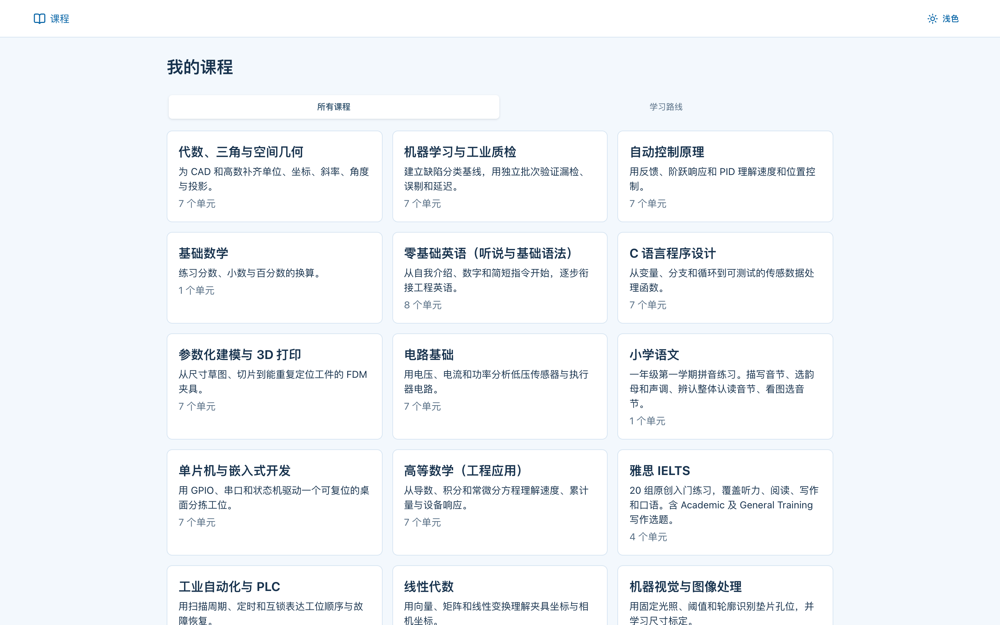
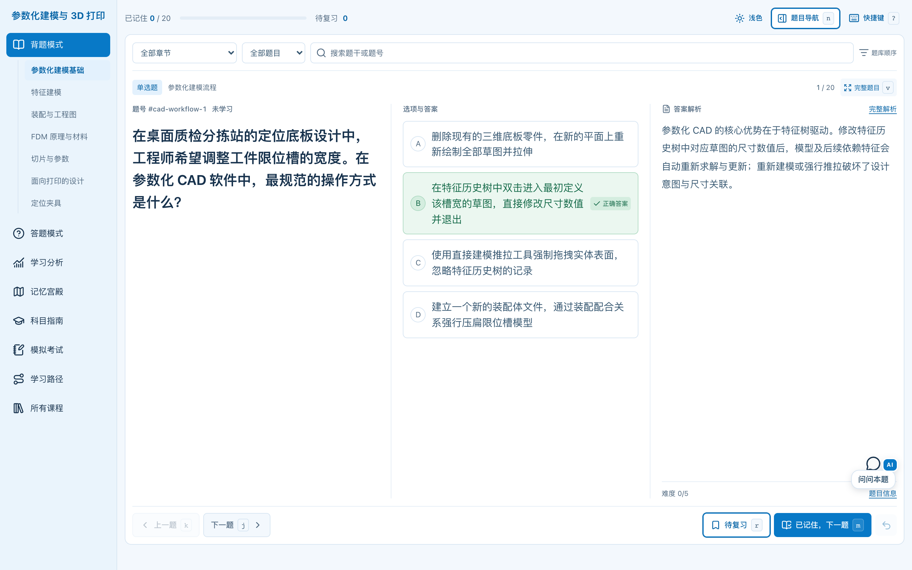
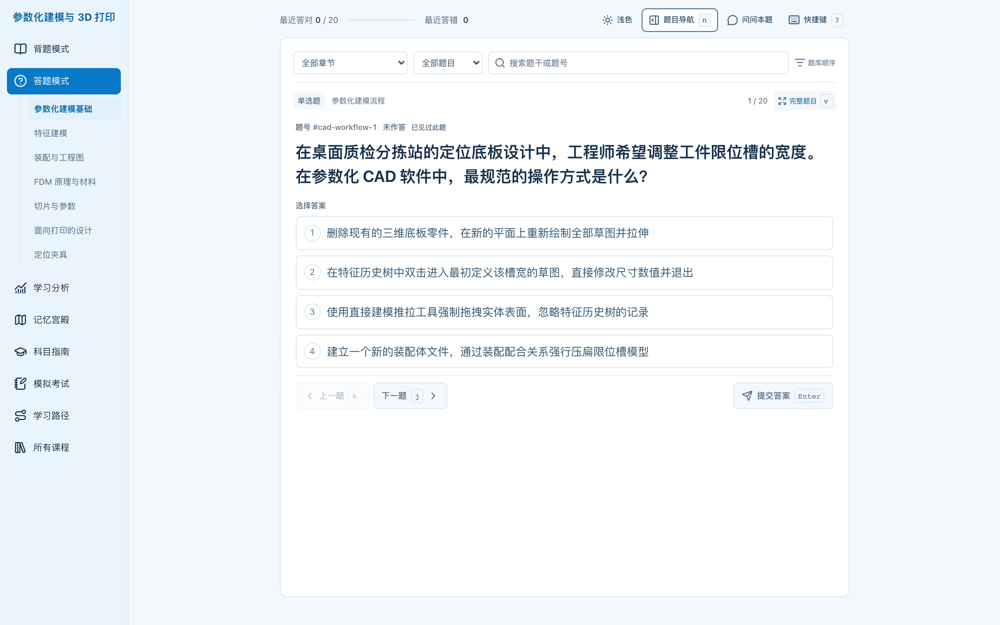
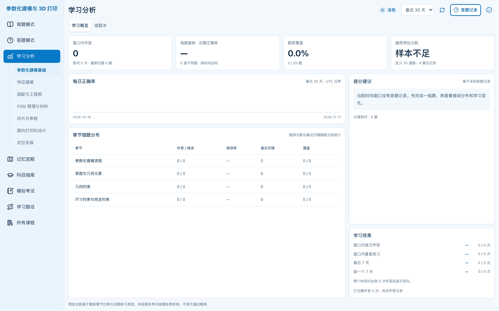
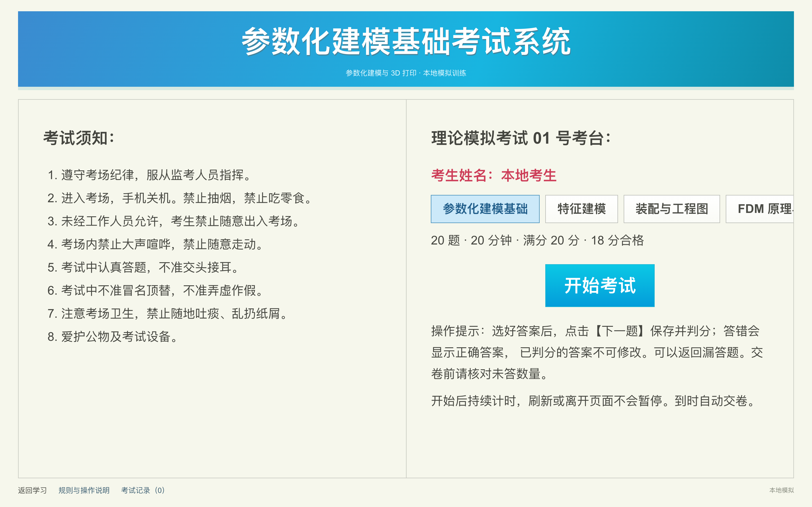

# Test-driven Study · 本地课程学习

<p align="center">
  <a href="README.md"><b>English</b></a> | <a href="README.zh-CN.md"><b>简体中文</b></a>
</p>

<p align="center">
  <a href="https://opensource.org/licenses/Apache-2.0"></a>
  <a href="CHANGELOG.md"></a>
  <a href="https://golang.org"></a>
  <a href="https://nodejs.org">=26"></a>
  <a href="https://react.dev"></a>
  <a href="https://www.typescriptlang.org"></a>
</p>

A local course study application with a Go backend, React and TypeScript
frontend, and SQLite storage. It ships with 18 courses, including Basic Math and
[Elementary Chinese](courses/elementary-chinese/course.json).

The interface is in Chinese. Studying does not require an account, API key,
or external database.

## Screenshots



| Subject Guide & Lesson Reading | Practice Mode & Focused Reading |
| :---: | :---: |
|  |  |
| **Learning Analysis & Error Tracking** | **Timed Mock Examination Terminal** |
|  |  |

## Desktop inspection and sorting study track

Build a printed fixture, use a microcontroller to detect a part and actuate a
sorting gate, and use a fixed camera to check for a hole. Validate this sequence
on one type of part before comparing a learned classifier with the rule-based
baseline on a separate batch. Record missed defects, false rejects, and cycle time.

| Stage | Courses |
| --- | --- |
| Fixture | [CAD and FDM printing](courses/cad-fdm-printing/README.md) |
| Electronics and firmware | [Circuits](courses/circuit-fundamentals/README.md), [C](courses/c-programming/README.md), [Microcontrollers](courses/embedded-mcu/README.md) |
| Inspection | [Python](courses/python-programming/README.md), [Machine vision](courses/machine-vision/README.md), [Tolerances and metrology](courses/tolerances-metrology/README.md) |
| Evaluation and automation | [Machine learning](courses/applied-machine-learning/README.md), [Industrial automation and PLCs](courses/industrial-automation/README.md), [PCB design elective](courses/pcb-design/README.md) |
| Supporting mathematics | [Algebra, trigonometry and geometry](courses/algebra-geometry/README.md), [Calculus](courses/engineering-calculus/README.md), [Linear algebra](courses/linear-algebra/README.md), [Probability and statistics](courses/probability-statistics/README.md), [Automatic control](courses/automatic-control/README.md) |
| Language | [Beginner English](courses/beginner-english/README.md) |

Each package is a sample course of about 30 study hours: seven or eight units
with a lesson per unit, a concept graph, 124–159 reviewed items in all four
graded question types and a self-check project. The course roadmap shows the
prerequisites that each README names; Microcontrollers, for example, requires
Circuits and C. Beginner English includes listening exercises with transcripts.

## Features

- **Courses (所有课程):** select a package and open the shared learning
  workspace. Each course keeps its own progress, practice, exams and AI
  history. The same controls support single choice, multiple choice,
  true/false and decimal answers across packages.

- **Subject guide (科目指南):** read the selected unit's lessons in a
  full-width reading pane with study guidance.
- **Memorization (背题模式):** read answers and explanations, mark questions as
  remembered or needing review, and resume your last question in each subject.
- **Practice (答题模式):** select answers with number keys, submit for grading,
  then view the explanation. Every submitted attempt is saved separately.
- **[Mock exams (模拟考试)](docs/features/mock-exam/README.md):** use the same
  timed terminal, saved papers and graded feedback for every question bank.
- **Learning analysis (学习分析):** inspect chapter errors, recent accuracy,
  coverage, first/repeat performance, and trends over 7, 30, or 90 days, or all time.
  The [wrong-question book](docs/features/learning-analysis/review-book.md) combines
  practice mistakes, mock exam mistakes, and assistant questions into a ranked
  review queue with spaced mastery checks.
- **[Learning paths (学习路径)](docs/features/learning-path/README.md):** courses
  that declare a concept graph get a path page and a graph view. Choose the whole
  course or chosen concepts and daily minutes; the plan follows AND/OR
  prerequisites, skips mastered or self-marked concepts, and links each step to
  filtered practice. Beginner English is the reference graph.
- **[Course roadmap (学习路线)](docs/features/course-roadmap/README.md):** the
  catalog's 学习路线 tab shows prerequisite relations between installed courses,
  taken only from the course READMEs, and plans a saved route to chosen courses.
  Courses with concepts complete through their concepts; others take a 已学完
  mark. Prerequisites order and label courses but never block one.
- **Question navigation:** filter by chapter or study state, search by text or
  original ID, and browse a continuous grid with jumps every 100 questions.
  Saved memory-palace images and assistant conversations have separate icons on
  question tiles; both can appear together.
- **Reading controls:** practice follows a focused question-and-answer lane with
  review below the actions. Memorization uses three desktop columns. Full content
  is also available in dialogs.
- **Question audio:** play marked passages and answer choices in supported
  courses. Listening exercises provide a recording or synthesized dialogue
  with an expandable transcript.
- **Light and dark themes:** switch from the toolbar and retain your choice across pages.
- **[Question assistant (学习助手)](docs/features/assistant/README.md):** click
  the practice toolbar button or the floating assistant in memorization and
  memory palace to ask about the current question. Replies stream with sources
  when the shared LLM search setting is enabled. Stop replies, start a new
  conversation or select history for the current question or all questions. LLM settings are
  shared with the existing Responses service. Drag the title bar to move the
  window or its bottom-right grip to resize it; the layout is remembered locally.
  Replies render Markdown with lists, links, tables and code. Conversations and
  citations are saved in SQLite and restored after reload or returning to a question.
- **Memory palace (记忆宫殿):** turn a question into an AI teaching image, review
  the full prompt, use the original diagram as a reference, and save/download
  results locally. Accepted jobs continue across page navigation.
  Model, aspect ratio, quality, and resolution retain their last selection;
  navigator image badges identify questions with saved memory pictures.
  A separately configured Responses LLM creates the scene plan automatically
  before the image stage; [retry only the image](docs/features/palace/image-only-retry.md)
  to reuse a satisfactory plan after image failure or to try another result.
- **Task management (任务管理):** inspect jobs across questions, pause at a safe
  checkpoint, continue, stop, or explicitly regenerate. Paused jobs survive
  service restarts; see [task controls](docs/features/palace/task-lifecycle.md) for recovery.
- **Execution traces:** inspect observed request intervals, hosted tool events,
  returned public reasoning summaries and incremental answers during generation.
  Saved traces remain available from the image panel. See
  [execution traces](docs/features/palace/execution-traces.md) for event semantics.

Study advice is based on recorded practice results. The score estimate describes
question-bank performance; it is not a calibrated exam score or pass probability.

## Quick start

Install Node.js 26+, npm 11+, and Go 1.26+. From the repository directory:

```sh
npm install
npm run dev
```

Open [the course catalog](http://127.0.0.1:43387/courses). The command starts the
frontend and Go API together. The first launch installs the bundled courses in
SQLite automatically. Select a course to open its workspace.
Stop the app with Ctrl+C.

To run in the background on macOS or Linux:

```sh
npm run dev:up
npm run dev:status
npm run dev:down
```

To build and run the application without the Vite development server:

```sh
npm run build
npm start
```

Open [the built app](http://127.0.0.1:43388/courses).

## Author a course

```sh
npm run course:new -- --id my-course --title "My Course" --language en
npm run course:check -- courses/my-course
npm run course:install -- courses/my-course
```

Edit the generated `course.json` and sample question before installing. The
scaffold also supplies editable research, scene planning and image prompts
under `profiles/`. Its `PROMPT-AUTHORING.md` includes fill-ins, worked examples
and a review rubric for the three stages. The Markdown lesson is optional.
The Go loader validates local references and typed answers in both `check`
and `install`. Reload the catalog after installation. Use
`--data-dir <directory>` before the package path if your server gets
`STUDY_DATA_DIR` from a dotenv file.

A course update preserves the course ID and existing item IDs and uses a new
package version. Startup installs only bundled courses that are missing, so an
existing database receives a bundled patch version through `course:install`.
An installed version stays readable for submitted and pending attempts.
Reinstalling a validated version activates it again, so an earlier version can
serve as a rollback.

See the [course protocol](contracts/course/v1/README.md) for file layout,
answer formats, validation, and offline behavior. See the
[shared workspace design](docs/features/course-platform/shared-learning-workspace.md)
for ownership and migration.

### Configuration

Optional settings go in a `.env` file; see [.env.example](.env.example).

```dotenv
STUDY_WEB_PORT=43387
STUDY_API_PORT=43388
STUDY_DATA_DIR=var
```

| Service | Default address |
| --- | --- |
| Development frontend | http://127.0.0.1:43387 |
| Go API and built application | http://127.0.0.1:43388 |
| Browser acceptance frontend / API | Ports 43287 / 43288 |
| Browser acceptance provider fixture | Port 43289 |

Learning progress and answer history are stored in `var/study.sqlite`, or in
`STUDY_DATA_DIR` when configured. Stop the application before copying the database
for a backup. Generated images, cached speech and resumable LLM state are also
stored under the data directory. Background-service logs default to `var/dev.log`.

### Optional text-to-speech

Open **记忆宫殿 → 生图设置 → TTS · 语音服务** to configure the DeepSeek endpoint,
dedicated API key, default voice and proxy. The API key is stored in the OS
credential store. The application caches generated audio by voice and phrase
under `var/audio/` or the configured data directory. See the
[TTS feature reference](docs/features/tts/README.md).

### Optional AI image generation

Open **记忆宫殿 → 生图设置 → 生图服务** to configure a GPT Image-compatible Base URL,
API key, model names, and explicit proxy. **测试连接** checks the model list;
**保存并应用** saves and applies the configuration without a restart.

The API key and proxy authentication are saved in the operating system's
credential store: macOS Keychain, Windows Credential Manager, or Linux Secret
Service. The page never returns a saved key; leave the input blank to retain it.
System credential storage must be available and unlocked. A failed save keeps
the previous configuration and does not fall back to a plaintext file.

For environment-based setup, copy [.env.gpt-image2.example](.env.gpt-image2.example)
to `.env.gpt-image2`, fill the settings, and restart. Saved UI settings take
precedence. The ignored dotenv file remains an explicit bootstrap option;
clearing a key in the UI does not modify that file or revoke the provider key.

Open **记忆宫殿** from the sidebar to generate one image for the current question.
Choose a model, quality, size, optional palace address, and whether to attach the
original diagram. Review **查看完整提示词** before submitting. The default model
is `gpt-image-2` when configured. Other service-specific aliases remain selectable.
Resolution offers 1K/2K/4K tiers with visible pixel dimensions. All presets obey
the model's multiple-of-16, edge, ratio, and pixel-area limits. The top 2:3 tier
is capped at 2336×3504 and labeled accordingly; 9:16 4K is 2160×3840.

Remote model requests and result downloads require a proxy and never fall back
to direct access. Generation has no automatic paid-request retries. Failed or
interrupted jobs require explicit regeneration. Canceling local waiting does
not guarantee upstream cancellation or no charge. AI labels and explanations
need review; the image service does not verify current regulations.

Images are saved under `var/palaces/`, or the configured data directory. Back up
that directory with `study.sqlite`. Ordinary study modes work without AI settings.
Credentials belong to the local OS account; re-enter them after moving to a
different computer. Linux servers without Secret Service should use the dotenv
or process-environment option. See the [configuration reference](docs/features/palace/README.md).

### Automatic LLM-to-image pipeline

**生图设置 → LLM · Responses** configures an independent text-model provider.
Set its Base URL, API key, model list, default model, reasoning effort, session
budget in K, and proxy. Image and LLM providers use separate settings, keys and
OS credential entries. For bootstrap configuration, copy
[.env.gpt.example](.env.gpt.example) to `.env.gpt` and restart. Saved LLM settings
take precedence over that file.

Select **生成一张** to run **LLM scene planning → structured validation → image
generation → local saving**. No intermediate approval or adoption is required.
The backend owns the pipeline, so switching pages, closing a dialog or reloading
does not stop an accepted job. The canvas shows both stages and their status.

Expand **构思参数** to choose the LLM model, reasoning effort and session budget.
Preferences retain their last selection. **模型默认** omits the effort parameter;
accepted values depend on the configured endpoint and model.

The LLM receives the question, teaching template and original diagram,
independently of the image-generator reference switch. Animated GIFs become up
to eight labeled reference frames. A validated scene supplements the canonical
prompt. **生成详情** retains the plan, exact prompt and provider-reported usage.

**联网研究** requires hosted search by default. Source claims must match actual
retrieval records. Insufficient evidence reopens research; explicit conflicts,
refusal and invalid output stop before images. Repeated research without new
evidence stops rather than issuing unlimited identical requests.

Working context defaults to **274 K: 210 K compaction threshold + 64 K reserve**.
**1 K = 1024 tokens**, including reasoning and visible output. The per-response
allowance derives from reserve; the hosted search window can require earlier
compaction. The workflow retains the original question/images and actual sources
through supported compaction protocols. See the
[pipeline reference](docs/features/palace/README.md) for details.

The **任务** panel controls pause, continue, stop and explicit regeneration.
Live and saved execution traces report observed activity. Uncertain paid requests
are not replayed. Requests use `store: false`; provider retention policies still
apply. Review generated teaching content against the original question.

## Using the app

Choose a mode and subject from the left navigation. Both study modes support
chapter filters, state filters, text search, original images, and full explanations.

In practice mode, choose one option for single-choice or true/false questions;
choose all applicable options for multiple-choice questions. Press Enter to
submit. Once the result is saved, press Enter again to advance. Repeating a
question creates a new attempt and preserves earlier results.
After grading, the right-side Submit button becomes Next, with Retry immediately
to its left. The separate Previous/Next pair remains available on the left.

The navigator displays each question's position in the filtered list and its
original ID. These numbers can differ. **Locate current question (定位当前题)**
centers and focuses the current tile. Hundred-question jumps use list positions.

### Keyboard shortcuts

| Keys | Action |
| --- | --- |
| `1`–`4` | Select or toggle an option in practice mode. |
| `Enter` | Submit in practice mode; after grading, advance to the next question. |
| `j` / `k`, `→` / `←` | Next / previous question. |
| `↓` / `↑` | Scroll a visible long explanation, including its dialog. |
| `gg` / `G` | First / last question in the filtered list. |
| `/` | Focus search. |
| `n` | Open question navigation. |
| `v` | Open the complete question. |
| `f` | Enlarge the question image. |
| `m` | Mark remembered and advance in memorization mode. |
| `r` | Toggle review in memorization mode; retry after grading in practice mode. |
| `u` | Clear the memorization mark. |
| `?` | Open keyboard help. |
| `Esc` | Close a dialog or leave the search field. |

Keyboard help includes a switch for single-character shortcuts. Text entry,
input-method composition, and native control navigation retain their controls.

## Question banks and local data

[courses/defaults.json](courses/defaults.json) lists the bundled packages. Course
question files, lessons and media live under `courses/<course-id>/`. Question
images and audio are served locally.

## Development

The frontend uses React, TypeScript, Vite, TanStack Query, and Radix UI. The Go
service handles grading, study records, statistics, SQLite migrations, and local
assets. HTTP contracts use OpenAPI; sqlc generates SQL bindings. Hey API generates
types only; its [maintenance assessment](docs/technical-selection/http-contracts/hey-api-maintenance.md)
documents the pinned version and replacement conditions.
```sh
npm run typecheck
npm run test:unit
npm run test:go
npm run test:e2e
npm run check
```

Browser tests use isolated databases and a loopback image-provider fixture on
port 43289; they never use real AI keys or make paid requests. They require Playwright Chromium or an
installed Google Chrome. Historical browser scenarios are under
`tests/legacy-browser/`. Install Chromium when neither browser is available with
`npx playwright install chromium` through your configured proxy.

`npm run generate` regenerates HTTP types and SQL bindings. SQL generation runs
without network access and requires sqlc v1.31.1 in the Go module cache. Prepare
that cache once through your configured proxy with
`go run github.com/sqlc-dev/sqlc/cmd/sqlc@v1.31.1 version` before running generation
or the complete `npm run check` command.

```text
courses/          Versioned course packages and bundled course list
cmd/server/       Go server entry point
cmd/course/       Course authoring and installation CLI
internal/course/  Package validation, question types, and course profiles
internal/httpapi/ HTTP endpoints and validation
internal/storage/ SQLite import, migrations, and generated queries
internal/study/   Memorization, grading, and learning statistics
internal/palace/  Image provider, durable jobs, local images
web/src/          React pages, shared controls, themes, and API types
contracts/http/   OpenAPI contract
contracts/course/ Course-package schema and behavioral specification
tests/            Browser and startup checks
scripts/          Development, build, and generation commands
docs/             Feature documentation and UI references
```

Mock exams draw from the selected unit and retain the saved paper and grading rules.
