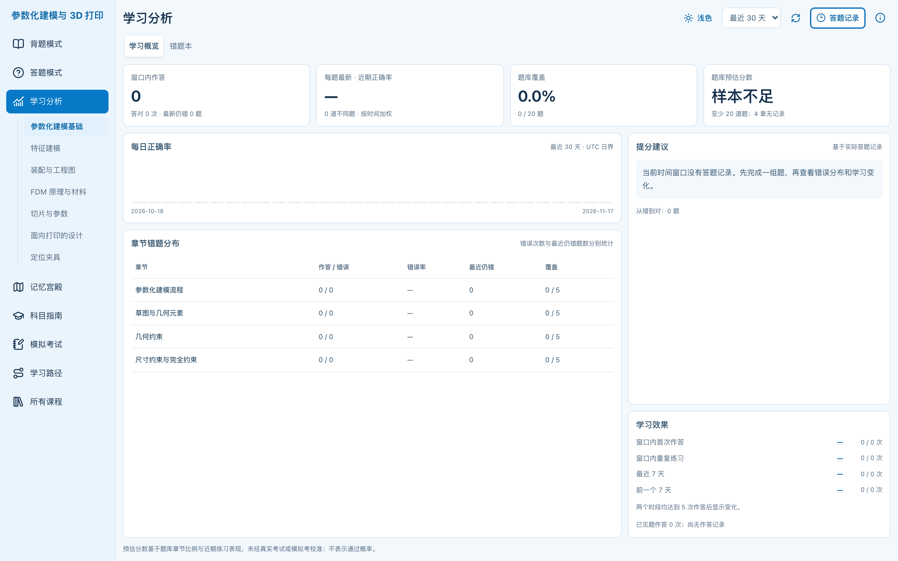
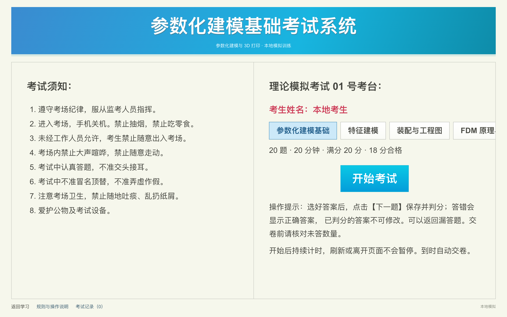

# Test-driven Study · 本地课程学习

<p align="center">
  <a href="README.md"><b>English</b></a> | <a href="README.zh-CN.md"><b>简体中文</b></a>
</p>

<p align="center">
  <a href="https://opensource.org/licenses/Apache-2.0"></a>
  <a href="CHANGELOG.md"></a>
  <a href="https://golang.org"></a>
  <a href="https://nodejs.org">=26"></a>
  <a href="https://react.dev"></a>
  <a href="https://www.typescriptlang.org"></a>
</p>

**Test-driven Study** 是一个完全自包含的本地化课程学习系统。采用 Go 后端服务、React 19 + TypeScript 前端与嵌入式 SQLite 本地持久化存储。当前主仓库默认内置三套核心课程包：[零基础英语](courses/beginner-english/README.md)、[小学语文拼音](courses/elementary-chinese/course.json) 与 [黄金标准课程模板](courses/golden-course-template/README.md)；其余 16 门理工与数学课程已拆分至独立课程仓库 `/Volumes/1TB-ZYJ/git/Test-driven-Study-Courses`，可按需通过 `npm run course:install` 导入使用。

日常学习与刷题完全在本地离线运行，无需注册账号、无需外置数据库、无需联网或配置付费 AI Key。

---

## 界面展示


| 科目指南与全宽课件阅读 | 答题模式与沉浸式阅读流 |
| :---: | :---: |
|  |  |
| **全景学习分析与错题本** | **全真倒计时模拟考试终端** |
|  |  |

---

## 主仓库内置课程

| 课程 | 版本 | 内容说明 |
| :--- | :--- | :--- |
| **[零基础英语](courses/beginner-english/README.md)** | `2.5.0` | 12 个单元、51 个知识点、507 道覆盖全部 9 类 v2 题型的题目，全部 45 道阅读与 67 道听力题均配英中对照，含 93 条生词本与 TTS/极简语法点拨。 |
| **[小学语文拼音](courses/elementary-chinese/course.json)** | `1.0.4` | 填空题干配本地拼音录音，选项与解析支持汉字 TTS 与本地拼音串联朗读。 |
| **[黄金标准课程模板](courses/golden-course-template/README.md)** | `1.4.0` | 覆盖全部 9 类 v2 题型、5 节点知识图谱、阅读/听力英中对照及 12 条生词本示例。 |

其余 16 门工程与数学拓展课程统一存放在独立仓库 `/Volumes/1TB-ZYJ/git/Test-driven-Study-Courses`。

---

## 核心功能与工作区

- **所有课程 (Course Catalog)**：统一的学习工作区。支持直接在网页导入本地 `.zip` 课程包，切换已安装版本、停用或重新启用课程且完整保留学习历史；每门课程独立追踪学习进度、做题历史、考试记录与 AI 交互历史。
- **科目指南 (Subject Guide)**：提供全宽排版的单元课件阅读器与学习目标指引。
- **背题模式 (Memorization)**：直接展示正确答案与解析，支持键盘快捷键快速标记“已掌握”或“需复习”，自动断点续学，并内置生词本与阅读/听力英中对照切换。
- **答题模式 (Practice)**：支持数字快捷键极速答题、回车提交判分并即时查看深度解析，每次练习历史独立归档；写作与翻译题提交后支持离线按 Rubric / 参考译文与关键词自评通关，也支持持久化缓存的可选 AI 评分。
- **小学语文朗读**：题干和选项中的拼音使用本地录音。提交后可播放答案解析，汉字由
  TTS 合成，拼音播放本地录音。可在「生图设置 → TTS · 语音服务」配置默认音色。
- **模拟考试终端 (Mock Exam)**：独立全真考试界面，服务端强校验倒计时、基于蓝图抽卷并生成原子分值与题型报表。
- **学习分析与错题本 (Learning Analysis)**：按章节、正确率、做题覆盖度、初次/重测多维度提供趋势雷达图；内置优先级错题本（结合练习错题、考试错题与助教问答生成智能复习队列，自动排除冷却期内题目）。
- **知识图谱与学习路径 (Learning Paths)**：基于有向无环图（DAG）可视化知识点前置依赖，智能规避已掌握概念并生成定制刷题包。
- **跨课程学习路线图 (Course Roadmap)**：自动解析各课程间的前置修读关系，为学习者规划跨学科成长路径。
- **打字学习浮窗 (Typing Study)**：在背题模式、记忆宫殿与答题模式提交判分后（交卷前禁用防泄密），打开可拖拽的逐句打字浮窗，基于当前题目与正确答案按句练习（覆盖全部 9 类题型）。支持中英文与双语混合句、中文输入法组词防误判（拼音未选词上屏不提前标红）、长文本打字机自动上滚、`全部（题+答）`/`仅英文`/`仅答案` 范围切换、`跟打原文`/`默写提示` 与 `Tab` 逐词提示。
- **AI 智能助教与记忆宫殿 (AI Tutor & Memory Palace)**：支持基于课程资料与上下文压缩的 AI 辅导问答；内置多模态记忆宫殿生成管道（默认强制显式代理且零静默直连回退，支持在设置页手动勾选 `"Allow direct HTTPS"` 显式放行直连 HTTPS，并支持本地 Mock Fixture 隔离测试）。

---

## 快速上手与运行

### 环境要求
- **Node.js**：`>= 26.0.0`
- **npm**：`>= 11.0.0`
- **Go**：`>= 1.26.0`

### 安装与启动
```bash
# 1. 克隆代码仓库
git clone https://github.com/meomeo-dev/Test-driven-Study.git
cd Test-driven-Study

# 2. 安装前端依赖
npm install

# 3. 启动开发模式（同时拉起前端 Vite 与 Go API 后端）
npm run dev
```
启动后打开[课程目录](http://127.0.0.1:43387/courses)。Go API 使用端口
`43388`。

已有数据库通过 `npm run course:install -- courses/elementary-chinese`
升级小学语文课程包。

### 构建、制课与测试
```bash
# 执行类型检查与前端打包，同时编译 Go 生产二进制
npm run build

# 生成 v2 课程脚手架与运行统一课程质量审计
npm run course:new -- --id my-course --title "My Course" --language en
npm run course:audit -- --strict courses/beginner-english

# 运行单元、Go、启动与编译产物 E2E 校验（完整门禁为 npm run check）
npm run test:unit
npm run test:go
npm run test:e2e
npm run issue:check
```

---

## 开源协议

本项目采用 [Apache-2.0](LICENSE) 商业友好开源许可证。
