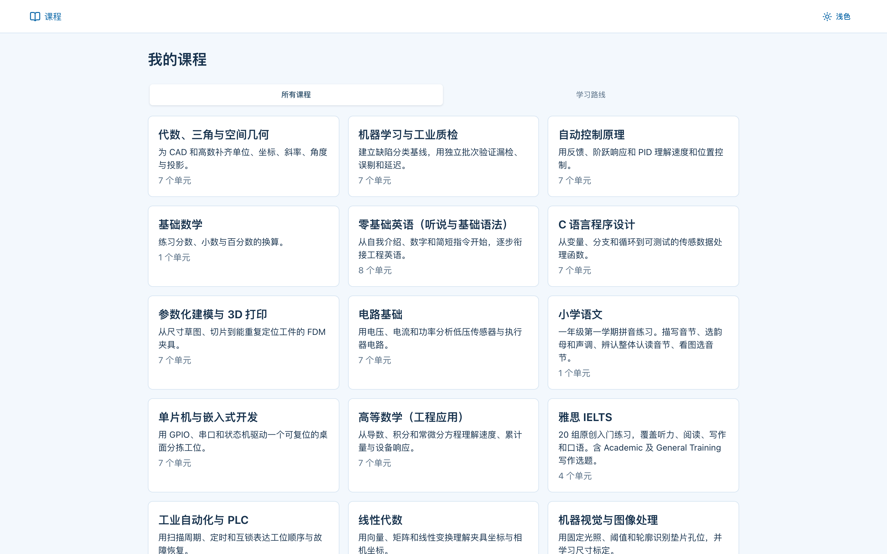
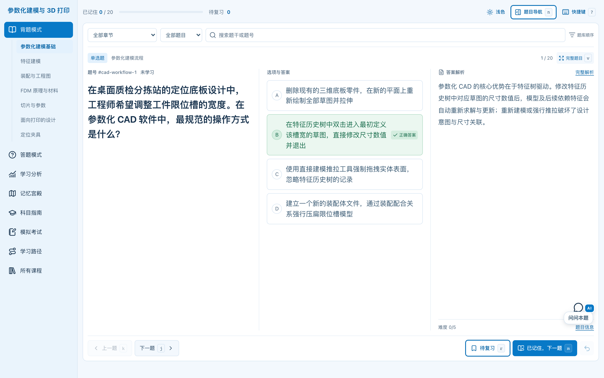
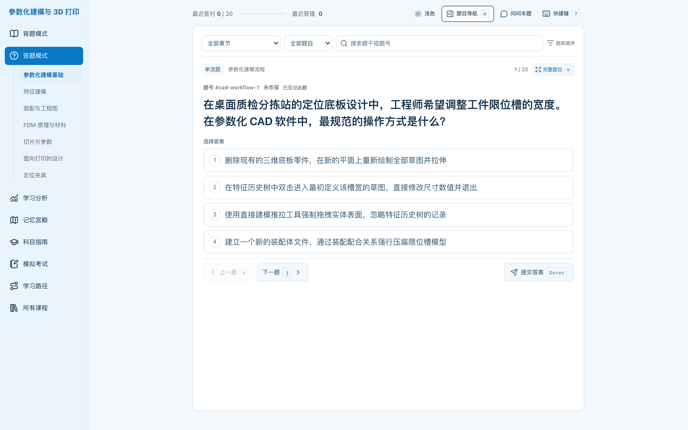

# Test-driven Study · 本地课程学习

<p align="center">
  <a href="README.md"><b>English</b></a> | <a href="README.zh-CN.md"><b>简体中文</b></a>
</p>

<p align="center">
  <a href="https://opensource.org/licenses/Apache-2.0"></a>
  <a href="CHANGELOG.md"></a>
  <a href="https://golang.org"></a>
  <a href="https://nodejs.org">=26"></a>
  <a href="https://react.dev"></a>
  <a href="https://www.typescriptlang.org"></a>
</p>

**Test-driven Study** 是一个完全自包含的本地化工程与学科课程学习系统。采用 Go 后端服务、React 19 + TypeScript 前端与嵌入式 SQLite 本地持久化存储。项目内置 18 门自研标准化课程，涵盖工业机械、电子嵌入式、软件编程、工程数学及基础学科。

日常学习与刷题完全在本地离线运行，无需注册账号、无需外置数据库、无需联网或配置付费 AI Key。

---

## 界面展示



| 科目指南与全宽课件阅读 | 答题模式与沉浸式阅读流 |
| :---: | :---: |
|  |  |
| **全景学习分析与错题本** | **全真倒计时模拟考试终端** |
|  |  |

---

## 桌面工业分拣技术学习主线

系统设计以“桌面零件视觉检测与分拣工作站”为主线场景，将 18 门学科贯穿为一条清晰的工程学习与技能树：

| 工程阶段 | 涵盖课程 |
| :--- | :--- |
| **机械夹具** | [CAD 与 FDM 3D 打印](courses/cad-fdm-printing/README.md) |
| **电子硬件与固件** | [电路基础](courses/circuit-fundamentals/README.md)、[C 语言编程](courses/c-programming/README.md)、[嵌入式微控制器 MCU](courses/embedded-mcu/README.md) |
| **视觉检测与公差** | [Python 编程](courses/python-programming/README.md)、[机器视觉](courses/machine-vision/README.md)、[公差配合与几何测量](courses/tolerances-metrology/README.md) |
| **算法评估与产线自动化** | [应用机器学习](courses/applied-machine-learning/README.md)、[工业自动化与 PLC 控制](courses/industrial-automation/README.md)、[PCB 设计选修](courses/pcb-design/README.md) |
| **工程数学支撑底座** | [代数、三角与几何](courses/algebra-geometry/README.md)、[工程微积分](courses/engineering-calculus/README.md)、[线性代数](courses/linear-algebra/README.md)、[概率论与数理统计](courses/probability-statistics/README.md)、[自动控制原理](courses/automatic-control/README.md) |
| **语言与通识基础** | [初级英语（含听力原声与听写文本）](courses/beginner-english/README.md)、[小学语文拼音](courses/elementary-chinese/course.json)、[基础数学](courses/basic-math/course.json) |

每个标准课程包均包含独立的 7~8 个单元课件、概念知识图谱（Concept Graph）、124~159 道精编题目（支持单选、多选、判断、数值填空四类题型）以及自检实践项目。

---

## 核心功能与工作区

- **所有课程 (Course Catalog)**：统一的学习工作区。每门课程独立追踪学习进度、做题历史、考试记录与 AI 交互历史。
- **科目指南 (Subject Guide)**：提供全宽排版的单元课件阅读器与学习目标指引。
- **背题模式 (Memorization)**：直接展示正确答案与解析，支持键盘快捷键快速标记“已掌握”或“需复习”，自动断点续学。
- **答题模式 (Practice)**：支持数字快捷键极速答题、回车提交判分并即时查看深度解析，每次练习历史独立归档。
- **小学语文朗读**：题干和选项中的拼音使用本地录音。提交后可播放答案解析，汉字由
  TTS 合成，拼音播放本地录音。可在「生图设置 → TTS · 语音服务」配置默认音色。
- **模拟考试终端 (Mock Exam)**：独立全真考试界面，服务端强校验倒计时、基于蓝图抽卷并生成原子分值与题型报表。
- **学习分析与错题本 (Learning Analysis)**：按章节、正确率、做题覆盖度、初次/重测多维度提供趋势雷达图；内置优先级错题本（结合练习错题、考试错题与助教问答生成智能复习队列）。
- **知识图谱与学习路径 (Learning Paths)**：基于有向无环图（DAG）可视化知识点前置依赖，智能规避已掌握概念并生成定制刷题包。
- **跨课程学习路线图 (Course Roadmap)**：自动解析各课程间的前置修读关系，为学习者规划跨学科成长路径。
- **AI 智能助教与记忆宫殿 (AI Tutor & Memory Palace)**：支持基于课程资料与上下文压缩的 AI 辅导问答；内置多模态记忆宫殿生成管道（支持本地 Mock Fixture 隔离测试）。

---

## 快速上手与运行

### 环境要求
- **Node.js**：`>= 26.0.0`
- **npm**：`>= 11.0.0`
- **Go**：`>= 1.26.0`

### 安装与启动
```bash
# 1. 克隆代码仓库
git clone https://github.com/meomeo-dev/Test-driven-Study.git
cd Test-driven-Study

# 2. 安装前端依赖
npm install

# 3. 启动开发模式（同时拉起前端 Vite 与 Go API 后端）
npm run dev
```
启动后打开[课程目录](http://127.0.0.1:43387/courses)。Go API 使用端口
`43388`。

已有数据库通过 `npm run course:install -- courses/elementary-chinese`
升级小学语文课程包。

### 构建与测试
```bash
# 执行类型检查与前端打包，同时编译 Go 生产二进制
npm run build

# 运行全套单元测试与校验
npm run test:unit
npm run test:go
npm run issue:check
```

---

## 开源协议

本项目采用 [Apache-2.0](LICENSE) 商业友好开源许可证。
