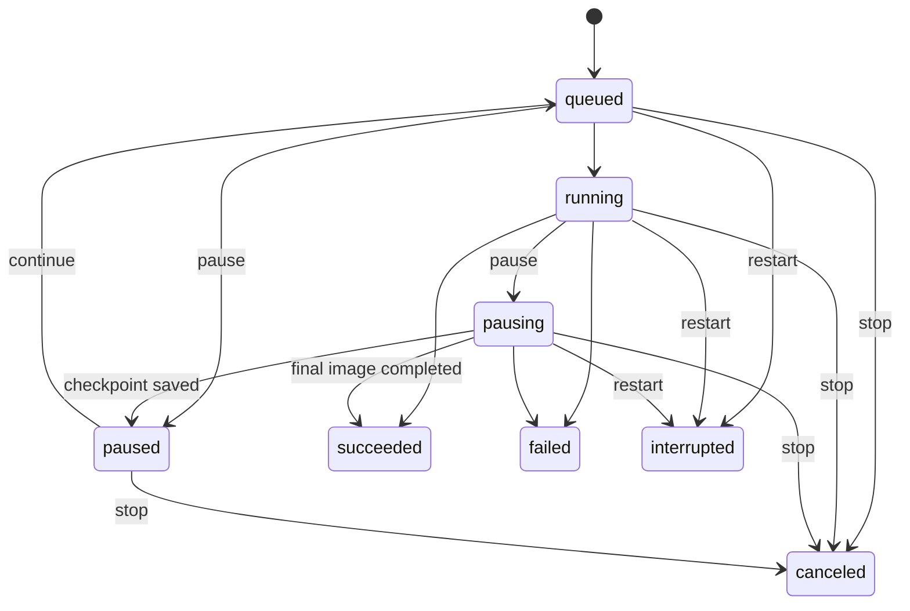

# Task lifecycle and recovery

The **任务** toolbar button lists unfinished tasks across both subjects. Select
**全部任务** for history, load earlier records, or open a task's original question.
The list includes the model, pipeline stage, status and persisted state events.
Tasks continue while the browser changes pages or closes.

| Command | Behavior |
| --- | --- |
| 暂停任务 | Pause queued work immediately. Running work finishes its current logical step and saves before pausing. |
| 继续任务 | Enqueue the same task ID from its saved checkpoint. |
| 终止任务 | Cancel local execution and prevent later stages. A stopped task cannot continue. |
| 重跑完整流程 | Create a new task ID with the previous settings and current template. |
| 仅重跑生图 | Reuse a saved final prompt and plan, with optional new image parameters. |
| 查看题目 | Open the source question and selected task. |

Running pause requests display **正在暂停** until the safe boundary is reached.
An LLM step includes any required compaction after that response. A completed
LLM plan and exact image prompt are committed before the image stage; continuing
at that boundary skips planning. If the final image request has already started,
its result is saved and the task can finish successfully while a pause is pending.
Pause does not discard a completed paid image.

Stop cancels the local request context. An upstream service can still complete or
charge an already submitted request. Failed, stopped and interrupted jobs require
explicit regeneration; they are never silently replayed. A retry is a new job,
not restoration of an uncertain request.

## States

Completed states are guarded against late worker output. Repeating pause/resume
or submitting the same retry ID does not duplicate a provider request. Ten
unfinished tasks, including paused tasks, may be retained at once. Provider
settings remain locked while unfinished tasks exist.

## Persistence and restart

SQLite stores the queue, image metadata, exact prompt snapshots and lifecycle
events. The migration records a historical state snapshot for existing jobs;
it does not reconstruct unavailable past transitions.

Private `llm-checkpoints/<task-id>.json` files beside `study.sqlite` retain the
Responses history, opaque reasoning/compaction items, evidence gap, reading
progress, cumulative token usage and no-progress counters. Files are atomically
written with mode `0600` inside a `0700` directory. Original image payloads are
replaced with hashed references and reloaded from validated local question assets.
Checkpoints store provider fingerprints, not API keys or provider URLs.

Only a saved **已暂停** task is recoverable after a service restart. The service
preserves that state and waits for an explicit continue command. Other queued,
running or pause-pending tasks become **服务中断**. In-flight checkpoint state is
never used to replay an uncertain paid request. Missing or changed checkpoints,
provider configuration or original image input fail closed without new AI calls.

Back up `study.sqlite`, `palaces/` and `llm-checkpoints/` together while the service
is stopped. Keep the matching question assets. OS credentials are separate and
must be configured again on a new machine. Completed and stopped checkpoint files
are removed; task records and generated images remain available.

## Local API

| Method and path | Result |
| --- | --- |
| GET `/api/tasks?scope=active` | Up to 50 unfinished task summaries across subjects. |
| GET `/api/tasks?scope=all&before=<cursor>` | History with a stable creation-time/ID cursor. |
| GET `/api/tasks/{id}/events` | Persisted state transitions in chronological order. |
| POST `/api/palaces/jobs/{id}/pause` | Request pause with an empty JSON object. |
| POST `/api/palaces/jobs/{id}/resume` | Continue a paused task with an empty JSON object. |
| POST `/api/palaces/jobs/{id}/cancel` | Stop local execution with an empty JSON object. |
| POST `/api/palaces/jobs/{id}/retry` | Explicit new job; body contains a new UUID in `id`. |
| POST `/api/palaces/jobs/{id}/retry-image` | New image attempt using the saved prompt and original plan. |

The controls cover palace jobs, including their LLM stage. Legacy standalone LLM
plan endpoints are separate from the palace queue. No additional service,
dependency or distributed scheduler is required.
