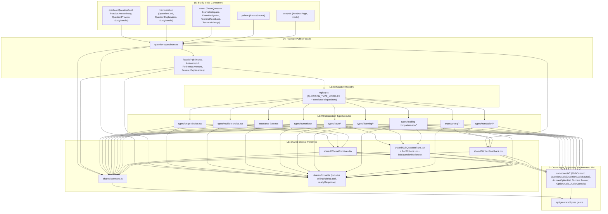
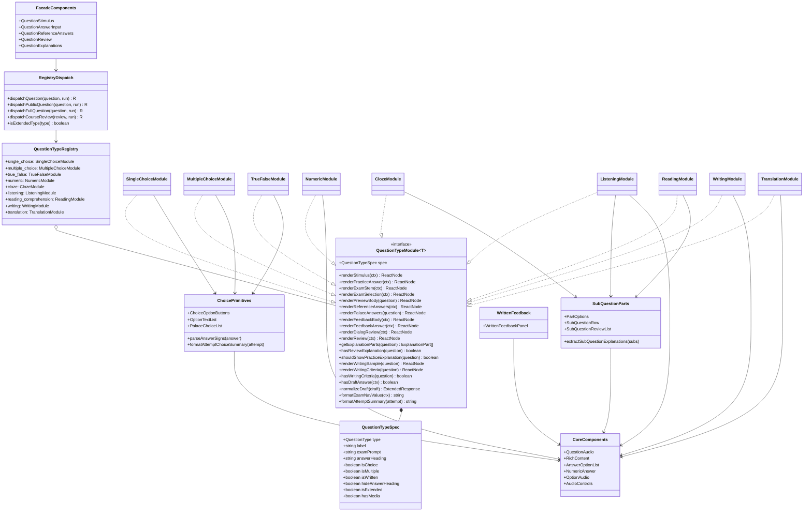

# Frontend Question-Type Module Architecture

Status: Proposed design (builds on [polymorphic-question-type-architecture.md](polymorphic-question-type-architecture.md) and audits `#71`, `#72`, and `#76`).

## 1. Goals and Current Coupling Problems

The backend and OpenAPI contracts (`contracts/http/openapi.yaml` -> `web/src/api/generated/types.gen.ts`) model the 9 semantic `QuestionType` values as discriminated unions (`Question`, `PublicQuestion`, `CourseItemReview`, `Attempt.question_type`). On the frontend, however, `web/src/features/question-types/` currently mixes cross-cutting switch dispatchers with type-specific components:

1. **Cross-cutting switch dispatchers**: `QuestionStimulus.tsx` (151 lines, 7 exports), `ExtendedQuestion.tsx` (150 lines, redundant `ExtendedQuestionInput` discriminated by `kind` instead of `question_type`), `ExtendedReference.tsx` (53 lines), `ExtendedReview.tsx` (141 lines), `ExtendedExplanations.tsx` (56 lines), and `model.ts` (`hasReviewExplanation`, `readyResponse`) repeat `switch` blocks across types.
2. **Upward and bi-directional coupling**: `web/src/components/QuestionAudio.tsx:7` imports `MediaQuestion` from `../features/question-types/registry`, creating an upward dependency from `web/src/components/` into a feature package. Inside `question-types/`, `model.ts`, `registry.ts`, `QuestionStimulus.tsx`, and `ExtendedReview.tsx` cross-import one another, and `WrittenFeedback.tsx:4` imports `writingRubricLabel` from `WritingContent.tsx`.
3. **Leaky internal imports**: `practice/`, `memorization/`, `exam/`, `palace/`, and `analysis/` bypass any package facade and import internal files directly (`ClozeContent.tsx`, `ReadingContent.tsx`, `TranslationContent.tsx`, `WritingContent.tsx`, `WrittenFeedback.tsx`, `ExtendedQuestion.tsx`, `ExtendedReview.tsx`, `ExtendedReference.tsx`, `QuestionStimulus.tsx`, `model.ts`, `registry.ts`), while repeating `switch (question.question_type)` in mode files.
4. **Length targets (`AGENTS.md`)**: `QuestionAudio.tsx` is 302 lines (`parseDialogueLines` is 34 lines). Inside `question-types/`, `SubQuestion` (80 lines), `PartOptions` (73 lines), `ExtendedQuestion` (107 lines), and `ExtendedReview` (87 lines) exceed the 30-line helper/function signal.

The target architecture organizes `web/src/features/question-types/` as **one cohesive package** containing:

- **9 independent per-type modules** (`types/*`),
- **shared internal primitives** (`shared/*`),
- **an acyclic registry and facade** (`registry.ts`, `facade/*`, `index.ts`).

---

## 2. Package Boundary and Directory Layout

```text
web/src/features/question-types/
├── index.ts                      # L4 Public facade: re-exports facades, shared helpers/WrittenFeedback, & types
├── registry.ts                   # L3 Exhaustive 9-type map + correlated-union dispatchers
├── question-types.css            # Package stylesheet (loaded in web/src/main.tsx after styles/*.css)
├── facade/                       # L4 Thin mode-facing React & helper dispatchers (import registry + shared)
│   ├── QuestionStimulus.tsx      # Stem stimulus (Audio / ClozePassage / ReadingPassage / Writing / Translation)
│   ├── QuestionAnswerInput.tsx   # Practice/Exam answer & preview dispatchers (replaces kind-based ExtendedQuestion)
│   ├── QuestionReferenceAnswers.tsx # Memorization/Palace reference & full-question views
│   ├── QuestionReview.tsx        # Post-submit ExtendedReview, FeedbackAnswerSummary, & DialogReviewContent
│   └── QuestionExplanations.tsx  # ExtendedExplanations, WritingSample/Criteria, & shouldShowExplanation
├── shared/                       # L1 Internal primitives (ZERO imports from registry, facade, or types/*)
│   ├── contracts.ts              # QuestionTypeModule<T>, QuestionTypeSpec, typed unions, assertNever
│   ├── format.ts                 # hasRichContent, creditLabel, readyResponse, writingRubricLabel, parseAnswerSigns
│   ├── ChoicePrimitives.tsx      # Shared choice formatting, judgment symbol mapping, AnswerOptionList adapter
│   ├── PartOptions.tsx           # CourseOption -> QuestionOption adapter + interactive option list
│   ├── SubQuestionParts.tsx      # SubQuestion input/review row shared by listening & reading_comprehension
│   ├── SubQuestionReview.tsx     # Shared sub-question feedback & explanation extractor
│   └── WrittenFeedback.tsx       # Shared AI evaluation panel (writing & translation; uses shared/format.ts)
├── types/                        # L2 9 independent per-type modules (NEVER import sibling types/* or registry)
│   ├── single-choice.tsx
│   ├── multiple-choice.tsx
│   ├── true-false.tsx
│   ├── numeric.tsx
│   ├── cloze/                    # Split into {index, components}.tsx so every file stays <= 300 lines
│   │   ├── index.tsx
│   │   └── components.tsx        # ClozePassage, ClozeBlankList, ClozeReview
│   ├── listening/
│   │   ├── index.tsx
│   │   └── components.tsx        # ListeningStimulus, SubQuestionList, ListeningReview
│   ├── reading-comprehension/
│   │   ├── index.tsx
│   │   └── components.tsx        # ReadingPassage, SubQuestionList, ReadingReview
│   ├── writing/
│   │   ├── index.tsx
│   │   └── components.tsx        # WritingRequirements, WritingEditor, WritingSample, WritingCriteria, WritingReview
│   └── translation/
│       ├── index.tsx
│       └── components.tsx        # TranslationSource, TranslationEditor, TranslationReference, TranslationReview
├── registry.test.ts              # 9-type completeness, zero cross-type leakage (@ts-expect-error)
└── model.test.ts                 # Shared helper & per-type draft/explanation/summary tests
```

### 2.1 Strict 5-Layer Acyclic Dependency DAG

Imports flow strictly downward (`L5 -> L4 -> L3 -> L2 -> L1 -> L0`). Sibling imports across `types/*` and upward imports into `registry.ts` or `index.ts` are forbidden.

1. **L0 — Cross-app UI Primitives & Generated API Types**:
   - `web/src/api/generated/types.gen.ts` (`QuestionType`, `Question`, `PublicQuestion`, `Attempt`, `CourseItemReview`, `SubQuestionReview`, etc.)
   - `web/src/components/` (`RichContent.tsx`, `AudioControls.tsx`, `OptionAudio.tsx`, `AnswerOptionList.tsx`, `NumericAnswer.tsx`, `QuestionAudio.tsx`)
   - **Required decoupling (`QuestionAudioSource`)**: `web/src/components/QuestionAudio.tsx` must remove its import from `features/question-types/registry`. Because `QuestionMediaFields` (`types.gen.ts:252-256`) and `package_id`/`package_version` on `QuestionBase` (`types.gen.ts:260-261`) are all optional, omitting `question_type` would allow `cloze`, `reading_comprehension`, `writing`, and `translation` to satisfy `QuestionAudioSource` and break the `@ts-expect-error` compile-time checks in `registry.test.ts:125-132`. Therefore, `QuestionAudio.tsx` defines the 5-type discriminant directly in L0 using `types.gen.ts`:

     ```ts
     export type QuestionAudioSource = Extract<
       Question | PublicQuestion,
       {
         question_type:
           | 'single_choice'
           | 'multiple_choice'
           | 'true_false'
           | 'numeric'
           | 'listening';
       }
     >;
     ```

   - `MediaQuestion` in `shared/contracts.ts` aliases `QuestionAudioSource` (or matches it identically) and is re-exported by `index.ts`.
2. **L1 — `question-types/shared/`**:
   - Imports only from L0 (`api/`, `components/`). Never imports `types/*`, `registry.ts`, `facade/*`, or `index.ts`.
   - `writingRubricLabel` moves from `WritingContent.tsx:24` into `shared/format.ts` so `shared/WrittenFeedback.tsx` (L1) and `types/writing/` (L2) share it without an upward L1 -> L2 dependency.
3. **L2 — `question-types/types/*` (9 independent modules)**:
   - Each module implements `QuestionTypeModule<T>` for a single `QuestionType` `T`.
   - Imports only from L0 and `../shared/*` (or `../../shared/*` inside `types/<type>/`). Never imports sibling `types/*`, `registry.ts`, `facade/*`, or `index.ts`.
   - Complex extended types (`cloze`, `listening`, `reading_comprehension`, `writing`, `translation`) use `types/<type>/{index,components}.tsx` so every file stays well below 300 lines and every helper stays `<= 30` lines.
4. **L3 — `question-types/registry.ts`**:
   - Imports the 9 module singletons from `./types/*` and contracts from `./shared/contracts` to build the exhaustive `QuestionTypeRegistry` map and correlated-union dispatchers.
5. **L4 — `question-types/facade/*` and `question-types/index.ts`**:
   - `facade/*` provides thin React and pure-function dispatchers over `registry.ts` + `shared/*`.
   - `index.ts` re-exports `facade/*`, `shared/WrittenFeedback` directly (no redundant `facade/WrittenFeedback.tsx` wrapper), `shared/format.ts` (`readyResponse`, `hasRichContent`, `creditLabel`, `questionType`), `registry.ts` (`QUESTION_TYPE_REGISTRY`, `isExtendedType`), and `shared/contracts.ts` (`assertNever`, union helpers).
6. **L5 — Study Mode Consumers**:
   - `web/src/features/practice/`, `memorization/`, `exam/`, `palace/`, `analysis/` import only from `../question-types` (`index.ts`), `../../components/*`, and their own mode-local files.
   - `web/src/main.tsx:14-28` keeps `./features/question-types/question-types.css` loaded after `./styles/*.css`.

---

## 3. UML Module, Class, and Sequence Diagrams

### 3.1 UML Package and Dependency Diagram



### 3.2 UML Class and Interface Diagram



### 3.3 UML Sequence Diagram (Mode Dispatch Across Practice, Memorization, and Exam)

```mermaid
sequenceDiagram
  autonumber
  actor Learner
  participant Mode as Mode Shell (Practice / Memorization / Exam)
  participant Facade as question-types/facade
  participant Reg as registry.ts (dispatch)
  participant Mod as Type Module
  participant Shared as shared/* + components/*

  Note over Mode,Shared: Flow A: Practice Cloze (Blank Jump -> Draft -> Submit -> Isolated Explanations)
  Mode->>Facade: QuestionStimulus(question, cloze onJump #clozeId-N)
  Facade->>Reg: dispatchQuestion(question, mod => mod.renderStimulus)
  Reg-->>Mod: clozeModule.renderStimulus(ctx)
  Mod->>Shared: RichContent(passage, renderBlank -> button "跳转到空格 N")
  Learner->>Shared: Click "跳转到空格 N"
  Shared-->>Mode: onJump(N) focuses #clozeId-N in answer pane
  Mode->>Facade: QuestionAnswerInput(question, hidePassage=true, partIdPrefix=clozeId)
  Facade->>Reg: dispatchPublicQuestion(question, mod => mod.renderPracticeAnswer)
  Reg-->>Mod: clozeModule.renderPracticeAnswer(ctx)
  Mod->>Shared: PartOptions(name="#clozeId-N", options)
  Learner->>Mode: Click "提交答案"
  Mode->>Facade: QuestionReview(review, response, credit, hideExplanations=true)
  Facade->>Reg: dispatchCourseReview(review, mod => mod.renderReview)
  Reg-->>Mod: clozeModule.renderReview(ctx)
  Mod-->>Mode: Per-blank feedback without leaking explanations into answer pane
  Mode->>Facade: QuestionExplanations(question)
  Facade->>Reg: dispatchFullQuestion(question, mod => mod.getExplanationParts)
  Reg-->>Mod: clozeModule.getExplanationParts(question)
  Mod-->>Mode: Blank explanations rendered only in QuestionExplanation / StudyDetails

  Note over Mode,Shared: Flow B: Memorization vs Practice Writing Sample Placement
  Mode->>Facade: QuestionReferenceAnswers(question, includeWritingSample)
  Facade->>Reg: dispatchFullQuestion(question, mod => mod.renderReferenceAnswers)
  Reg-->>Mod: writingModule.renderReferenceAnswers(ctx)
  alt Memorization / Palace (includeWritingSample = true)
    Mod-->>Mode: Renders WritingSample in answer/reference pane
  else Practice 完整原题 (includeWritingSample = false)
    Mod-->>Mode: Omits WritingSample from reference tab; renders it in QuestionExplanation
  end

  Note over Mode,Shared: Flow C: Exam Listening (Protected Audio) -> TerminalDialogs Review
  Mode->>Facade: ExamStem(listening question, protectedAudio)
  Facade->>Reg: dispatchQuestion(question, mod => mod.renderExamStem)
  Reg-->>Mod: listeningModule.renderExamStem(ctx)
  Mod->>Shared: QuestionAudio(question, protectedAudio)
  Note right of Shared: Server omits transcript_url / transcript_lines; "查看逐字稿" is absent
  Mod->>Shared: SubQuestionParts(sub_questions, studyRows=false)
  Learner->>Mode: Finishes exam and opens TerminalDialogs
  Mode->>Facade: DialogReviewContent(item, review) + ReviewAnalysis(review)
  Facade->>Reg: dispatchFullQuestion(review, mod => mod.renderDialogReview / mod.hasReviewExplanation)
  alt review.question_type is writing
    Mod-->>Mode: WritingReview -> WritingSample -> ReviewAnalysis(review) -> WritingCriteria
  else listening / cloze / reading_comprehension / translation
    Mod-->>Mode: ExtendedReview -> ReviewAnalysis(review) using hasReviewExplanation(review) to suppress "原题暂无解析。"
  end
```

---

## 4. TypeScript Interface Signatures and Soundness (`strict: true`)

### 4.1 Why Correlated-Union Dispatch Is Required

`QuestionTypeModule<T>` uses `T` in contravariant parameter positions (`StimulusContext<T>`, `PracticeAnswerContext<T>`, `QuestionOf<T>`). In TypeScript `strict: true`:

- Indexing `QUESTION_TYPE_MODULES[type]` when `type` is a union `QuestionType` yields `QuestionTypeRegistry[QuestionType]` (a union of all 9 module types), which is **not** assignable to `QuestionTypeModule<T>` (`TS2322`) and cannot accept a union `Question` at call sites (`getTypeModule(q.question_type).renderStimulus({ question: q })`).
- **Solution**: Keep `registry.ts` as the **single boundary** that performs runtime key lookup + correlated dispatch (`dispatchQuestion`, `dispatchPublicQuestion`, `dispatchFullQuestion`, `dispatchCourseReview`), and narrow dual-parameter inputs (`reviewQuestion?.question_type === question.question_type`) in the facade before dispatching.
- Similarly, standardizing explanation and criteria hooks on `question: QuestionOf<T>` (instead of `ReviewOf<T>`) matches `QuestionStimulus.tsx:98-151` and `TerminalDialogs.tsx:19-34`, because `SingleChoiceQuestion`, `MultipleChoiceQuestion`, `TrueFalseQuestion`, and `NumericQuestion` (`types.gen.ts:287-305`) have no `question_review` property while `ExamItem['review']` is typed as `Question`.

### 4.2 `shared/contracts.ts` (L1)

```ts
import type { ReactNode } from 'react';
import type {
  Attempt,
  CourseItemReview,
  ExtendedResponse,
  PublicQuestion,
  Question,
  QuestionType,
  RichText,
} from '../../../api/generated/types.gen';
import type { ProtectedAudio, QuestionAudioSource } from '../../../components/QuestionAudio';

export type QuestionOf<T extends QuestionType> = Extract<Question, { question_type: T }>;
export type PublicQuestionOf<T extends QuestionType> = Extract<
  PublicQuestion,
  { question_type: T }
>;
export type ReviewOf<T extends QuestionType> = Extract<CourseItemReview, { type: T }>;
export type AnyQuestion = Question | PublicQuestion;
export type AnyQuestionOf<T extends QuestionType> = QuestionOf<T> | PublicQuestionOf<T>;

export type MediaQuestion = QuestionAudioSource;

export type ChoiceQuestion = Extract<
  AnyQuestion,
  { question_type: 'single_choice' | 'multiple_choice' | 'true_false' }
>;

export type ExtendedQuestionType =
  | 'cloze'
  | 'listening'
  | 'reading_comprehension'
  | 'writing'
  | 'translation';

export type QuestionTypeSpec = {
  readonly type: QuestionType;
  readonly label: string;
  readonly examPrompt: string;
  readonly answerHeading: string;
  readonly isChoice: boolean;
  readonly isMultiple: boolean;
  readonly isWritten: boolean;
  readonly hideAnswerHeading: boolean;
  readonly isExtended: boolean;
  readonly hasMedia: boolean;
};

export type StimulusContext<T extends QuestionType> = {
  question: AnyQuestionOf<T>;
  cloze?: { value?: ExtendedResponse; onJump?: (index: number) => void };
  protectedAudio?: ProtectedAudio;
};

export type PracticeAnswerContext<T extends QuestionType> = {
  question: PublicQuestionOf<T>;
  reviewQuestion?: QuestionOf<T>;
  presentationId: string;
  result?: {
    score?: number;
    response?: ExtendedResponse;
    correctAnswer?: number[];
    correctNumeric?: string;
  };
  selected: number[];
  draft?: ExtendedResponse;
  numeric: string;
  pending: boolean;
  shortcuts: boolean;
  partIdPrefix: string;
  onChoose: (sign: number) => void;
  onDraft: (draft: ExtendedResponse) => void;
  onNumeric: (value: string) => void;
};

export type ExamStemContext<T extends QuestionType> = {
  question: AnyQuestionOf<T>;
  protectedAudio?: ProtectedAudio;
  draft?: ExtendedResponse;
  onDraft: (value: ExtendedResponse) => void;
  disabled: boolean;
};

export type ExamSelectionContext<T extends QuestionType> = {
  question: AnyQuestionOf<T>;
  selected: number[];
  numeric: string;
  onNumeric: (value: string) => void;
  onChoose: (sign: number) => void;
  disabled: boolean;
};

export type ExamFeedbackAnswerContext<T extends QuestionType> = {
  question: AnyQuestionOf<T>;
  review?: QuestionOf<T>;
  selected: number[];
  numeric?: string;
  response?: ExtendedResponse;
  credit?: number;
};

export type ExamDialogReviewContext<T extends QuestionType> = {
  question: AnyQuestionOf<T>;
  review: QuestionOf<T>;
  response?: ExtendedResponse;
  credit?: number;
  renderAnalysis: () => ReactNode;
};

export type ExamNavValueContext<T extends QuestionType> = {
  question: AnyQuestionOf<T>;
  selected: number[];
  numeric?: string;
  response?: ExtendedResponse;
};

export type ReferenceContext<T extends QuestionType> = {
  question: QuestionOf<T>;
  mode?: 'compact' | 'full';
  includeWritingSample?: boolean;
};

export type ReviewContext<T extends QuestionType> = {
  review: ReviewOf<T>;
  response?: ExtendedResponse;
  credit?: number;
  hideExplanations?: boolean;
};

export type ExplanationPart = {
  key: string | number;
  label: string;
  content: RichText;
};

export type DraftCheckContext = {
  selected: number[];
  numeric: string;
  canSubmitExtended: boolean;
};

export interface QuestionTypeModule<T extends QuestionType> {
  readonly spec: QuestionTypeSpec;

  // Mode rendering hooks
  renderStimulus: (ctx: StimulusContext<T>) => ReactNode;
  renderPracticeAnswer: (ctx: PracticeAnswerContext<T>) => ReactNode;
  renderExamStem: (ctx: ExamStemContext<T>) => ReactNode;
  renderExamSelection: (ctx: ExamSelectionContext<T>) => ReactNode;
  renderPreviewBody: (question: PublicQuestionOf<T>) => ReactNode;
  renderReferenceAnswers: (ctx: ReferenceContext<T>) => ReactNode;
  renderPalaceAnswers: (question: QuestionOf<T>) => ReactNode;
  renderFeedbackBody: (question: AnyQuestionOf<T>, response?: ExtendedResponse, review?: QuestionOf<T>) => ReactNode;
  renderFeedbackAnswer: (ctx: ExamFeedbackAnswerContext<T>) => ReactNode;
  renderDialogReview: (ctx: ExamDialogReviewContext<T>) => ReactNode;
  renderReview: (ctx: ReviewContext<T>) => ReactNode;

  // Explanation & supplement hooks (standardized on QuestionOf<T>)
  getExplanationParts: (question: QuestionOf<T>) => ExplanationPart[];
  hasReviewExplanation: (question: QuestionOf<T>) => boolean;
  shouldShowPracticeExplanation: (question: QuestionOf<T>) => boolean;
  renderWritingSample?: (question: QuestionOf<T>) => ReactNode;
  renderWritingCriteria?: (question: QuestionOf<T>) => ReactNode;
  hasWritingCriteria?: (question: QuestionOf<T>) => boolean;

  // Draft, exam navigation, and analysis formatting hooks
  hasDraftAnswer: (ctx: DraftCheckContext) => boolean;
  normalizeDraft?: (draft?: ExtendedResponse) => ExtendedResponse | undefined;
  formatExamNavValue: (ctx: ExamNavValueContext<T>) => string;
  formatAttemptSummary: (attempt: Attempt) => string;
}

export function assertNever(value: never): never {
  throw new Error(`Unhandled question type: ${JSON.stringify(value)}`);
}
```

### 4.3 `registry.ts` (L3)

```ts
import type {
  CourseItemReview,
  PublicQuestion,
  Question,
  QuestionType,
} from '../../api/generated/types.gen';
import type {
  AnyQuestion,
  AnyQuestionOf,
  ExtendedQuestionType,
  QuestionOf,
  PublicQuestionOf,
  QuestionTypeModule,
  QuestionTypeSpec,
  ReviewOf,
} from './shared/contracts';
import { clozeModule } from './types/cloze';
import { listeningModule } from './types/listening';
import { multipleChoiceModule } from './types/multiple-choice';
import { numericModule } from './types/numeric';
import { readingModule } from './types/reading-comprehension';
import { singleChoiceModule } from './types/single-choice';
import { translationModule } from './types/translation';
import { trueFalseModule } from './types/true-false';
import { writingModule } from './types/writing';

export type QuestionTypeRegistry = {
  readonly [K in QuestionType]: QuestionTypeModule<K>;
};

export const QUESTION_TYPE_MODULES: QuestionTypeRegistry = {
  single_choice: singleChoiceModule,
  multiple_choice: multipleChoiceModule,
  true_false: trueFalseModule,
  numeric: numericModule,
  cloze: clozeModule,
  listening: listeningModule,
  reading_comprehension: readingModule,
  writing: writingModule,
  translation: translationModule,
};

export const QUESTION_TYPE_REGISTRY: Record<QuestionType, QuestionTypeSpec> = {
  single_choice: singleChoiceModule.spec,
  multiple_choice: multipleChoiceModule.spec,
  true_false: trueFalseModule.spec,
  numeric: numericModule.spec,
  cloze: clozeModule.spec,
  listening: listeningModule.spec,
  reading_comprehension: readingModule.spec,
  writing: writingModule.spec,
  translation: translationModule.spec,
};

// Correlated-union dispatch helpers: runtime check + single internal bridge so
// strict TS callers never face TS2322 contravariance errors.
type AnyQuestionRunner<R> = <T extends QuestionType>(
  mod: QuestionTypeModule<T>,
  q: AnyQuestionOf<T>,
) => R;

export function dispatchQuestion<R>(question: AnyQuestion, run: AnyQuestionRunner<R>): R {
  const mod = QUESTION_TYPE_MODULES[question.question_type] as unknown as QuestionTypeModule<
    typeof question.question_type
  >;
  if (!mod) throw new Error(`Unhandled question type: ${JSON.stringify(question.question_type)}`);
  return run(mod, question as AnyQuestionOf<typeof question.question_type>);
}

export function dispatchPublicQuestion<R>(
  question: PublicQuestion,
  run: <T extends QuestionType>(mod: QuestionTypeModule<T>, q: PublicQuestionOf<T>) => R,
): R {
  const mod = QUESTION_TYPE_MODULES[question.question_type] as unknown as QuestionTypeModule<
    typeof question.question_type
  >;
  if (!mod) throw new Error(`Unhandled question type: ${JSON.stringify(question.question_type)}`);
  return run(mod, question as PublicQuestionOf<typeof question.question_type>);
}

export function dispatchFullQuestion<R>(
  question: Question,
  run: <T extends QuestionType>(mod: QuestionTypeModule<T>, q: QuestionOf<T>) => R,
): R {
  const mod = QUESTION_TYPE_MODULES[question.question_type] as unknown as QuestionTypeModule<
    typeof question.question_type
  >;
  if (!mod) throw new Error(`Unhandled question type: ${JSON.stringify(question.question_type)}`);
  return run(mod, question as QuestionOf<typeof question.question_type>);
}

export function dispatchCourseReview<R>(
  review: CourseItemReview,
  run: <T extends QuestionType>(mod: QuestionTypeModule<T>, r: ReviewOf<T>) => R,
): R {
  const mod = QUESTION_TYPE_MODULES[review.type] as unknown as QuestionTypeModule<
    typeof review.type
  >;
  if (!mod) throw new Error(`Unhandled question type: ${JSON.stringify(review.type)}`);
  return run(mod, review as ReviewOf<typeof review.type>);
}

export function isExtendedType(type: QuestionType): type is ExtendedQuestionType {
  return QUESTION_TYPE_REGISTRY[type].isExtended;
}
```

### 4.4 Dual-Parameter Facade Narrowing and Shared Checks

1. **Correlating `review` with `question` (`PracticeAnswerBody`, `TerminalFeedback`, `TerminalDialogs`)**:
   - In `facade/QuestionAnswerInput.tsx` and `facade/QuestionReview.tsx`, narrow `const matchedReview = reviewQuestion?.question_type === q.question_type ? (reviewQuestion as QuestionOf<typeof q.question_type>) : undefined` inside `dispatchQuestion` / `dispatchPublicQuestion` so a stale or mismatched review payload can never be handed to the wrong type module.
2. **Top-level `shouldShowExplanation` check (`PracticeAnswerBody.tsx:38-46`)**:
   - Keep the shared top-level guard once in `facade/QuestionExplanations.tsx`:

     ```ts
     export function shouldShowExplanation(question: Question): boolean {
       if (
         Boolean(question.analysis) ||
         hasRichContent(question.analysis_content) ||
         Boolean(question.analysis_audio?.length) ||
         Boolean(question.skill)
       ) {
         return true;
       }
       return dispatchFullQuestion(question, (mod, q) => mod.shouldShowPracticeExplanation(q));
     }
     ```

3. **Unconditional `readyResponse(draft)` (`PracticeSession.tsx:59`, `useExamTerminal.ts:31`)**:
   - `PracticeSession.tsx` computes `readyResponse(draft)` before checking `question_type`. Keep `readyResponse(draft)` exported from `shared/format.ts` -> `index.ts` alongside per-type `normalizeDraft` helpers.
4. **Bare `CourseItemReview` inspection (`model.test.ts`)**:
   - Keep `hasCourseReviewExplanation(review?: CourseItemReview): boolean` in `shared/format.ts` (or dispatched via `dispatchCourseReview` if delegating to modules) alongside `questionHasReviewExplanation(question: Question)` in `facade/QuestionExplanations.tsx`.

---

## 5. Per-Type Module vs. Shared Primitive Responsibility Matrix

| Type | Module Owns (`types/<type>`) | Delegated to `shared/*` or `components/*` |
| --- | --- | --- |
| `single_choice` | `spec` (`单选题`, `isChoice`, `hideAnswerHeading: false`), single-sign Practice/Exam/Palace/Feedback behavior, `formatExamNavValue`, `Attempt` summary (`你的选择 ... · 正确选项 ...`) | `QuestionAudio`, `ChoicePrimitives` (Practice `ChoiceOptions` numeric `.option-letter` + `data-sign`, Memorization `AnswerOptionList` `A/B/C`, Exam `OptionTextList` + `terminal-choice`, Palace `ol.palace-options`), `OptionAudio` |
| `multiple_choice` | `spec` (`多选题`, `isMultiple: true`, `可选择多项`), `CircleCheck`/`Circle` indicator flag, `data-multiple` nav semantics, `Attempt` summary | Same `QuestionAudio` + `ChoicePrimitives` + `OptionAudio` |
| `true_false` | `spec` (`判断题`), `judgment: true` icons in `AnswerOptionList`, `hasDetailedJudgmentOptions` suppression in Exam stem/feedback, `√`/`×` symbols, `judgmentOptionAt` keyboard `1`/`2`, `Attempt` `response?.value` vs `selected` | Same `QuestionAudio` + `ChoicePrimitives` + `OptionAudio` |
| `numeric` | `spec` (`数值题`, `填写答案`), `number_tolerance` metadata, `NumericAnswer` binding, `正确答案：{answer}` review/reference/feedback, `numeric.trim() !== ''` draft check, `formatExamNavValue`, `Attempt` summary | `QuestionAudio`, `NumericAnswer` |
| `cloze` | `spec` (`完形填空`), `ClozePassage` (`RichContent` `renderBlank` jump button / reviewed span), `ClozeBlankList` (`空格 {index}` fieldsets), `ClozeReview`, `getExplanationParts`, `shouldShowPracticeExplanation` (`blanks.length > 0`), `readyResponse` (`blanks`), `Attempt` summary (`完形作答（N 空）`) | `RichContent`, `PartOptions` (for blank choice options + `OptionAudio`), `format` |
| `listening` | `spec` (`听力题`, `hasMedia: true`), `QuestionAudio` stimulus (`protectedAudio` in Exam, no transcript leak), `SubQuestionList` (`studyRows = !!review`), `ListeningReview`, `getExplanationParts`, `shouldShowPracticeExplanation` (`sub_questions.length > 0`), `Attempt` summary (`小题作答（N 题）`) | `QuestionAudio`, `SubQuestionParts`, `PartOptions`, `SubQuestionReview`, `format` |
| `reading_comprehension` | `spec` (`阅读理解`), `ReadingPassage` (`aria-label="阅读材料"`), Practice post-submit `.reading-parts` inline `AnswerOptionList` + `role="status"` score line (no `ExtendedReview`), Exam `ExtendedReview`, `getExplanationParts`, stage `data-reading`, `Attempt` summary (`小题作答（N 题）`) | `RichContent`, `SubQuestionParts`, `PartOptions`, `SubQuestionReview`, `format` |
| `writing` | `spec` (`写作题`, `isWritten: true`, `hideAnswerHeading: true`), `WritingRequirements`, `WritingEditor` (word-count regex `/[\p{L}\p{N}\p{M}'’]+/gu`, `lang="en"`, `rows` 4/6, `maxLength={12000}`), `WritingSample` (`sample_response_tts`), `WritingCriteria`, `WritingReview`, `renderDialogReview` (`WritingReview -> WritingSample -> ReviewAnalysis -> WritingCriteria`), stage `data-writing`, `Attempt` summary (`写作作答（N 词）`) | `RichContent`, `WrittenFeedback` (`writing={true}`), `format` (`writingRubricLabel`) |
| `translation` | `spec` (`翻译题`, `isWritten: true`, `hideAnswerHeading: false`), `TranslationSource` (`lang={en|zh-CN}`), `TranslationEditor` (`中文译文`/`英文译文`), `TranslationReference` (`参考译文`, `可接受译法`, `关键术语`), `TranslationReview`, `shouldShowPracticeExplanation` (`!question.question_review`), `Attempt` summary (`翻译作答`) | `WrittenFeedback` (`writing={false}`), `format` |

### Why Choice Chrome Remains Mode-Parameterised in `ChoicePrimitives`

As documented in `#72`, the 4 choice consumers render intentionally different DOM/ARIA chrome:

- **Practice (`ChoiceOptions`)**: `<button className="answer-option choice-option">` with numeric `option.sign` inside `.option-letter`, `data-sign={option.sign}` (targeted by `PracticeSession.tsx:86-88` keyboard focus), `aria-pressed`, and `aria-label="选项${sign}：${title}"`.
- **Memorization & Reviewed Reading (`AnswerOptionList`)**: read-only `<div role="listitem" className="answer-option">` mapping `sign` to `A/B/C` (`String.fromCharCode(64 + option.sign)`) or `CircleCheck`/`Circle` for `judgment`.
- **Exam (`ExamQuestion` / `TerminalFeedback`)**: splits stem `<ol className="terminal-option-text">` (`A/B/C` or `√/×` via `optionSymbol`) from the selection keypad `<button className="terminal-choice">` (`useTerminalKeys.ts` permits `Enter` only on `.terminal-choice` and `.terminal-next`).
- **Palace (`PalaceSource`)**: `<ol className="palace-options">` with `${item.sign}. ${item.item_title}` and `<b>正确</b>`.

Attempting to force all 4 into a single `<ChoiceButton>` component would break keyboard shortcut selectors, CSS rules, and E2E locators. Instead, `ChoicePrimitives.tsx` shares the pure option-formatting/judgment logic (`parseAnswerSigns`, `optionSymbol`, `answerSymbols`, `hasDetailedJudgmentOptions`, `judgmentOptionAt`, `PalaceChoiceList`, `OptionTextList`) while keeping the 4 mode button/list renderers explicit and small.

---

## 6. Invariant Guardrails and Anti-Overengineering Checklist

When implementing this architecture in `web/src/features/question-types/`, verify every item below:

1. **Writing sample and answer-heading distinction**:
   - `memorization` and `palace` render `WritingSample` in the answer/reference pane (`includeWritingSample = true`) and omit it from explanation/analysis; `practice` renders it in `QuestionExplanation` / `完整解析` and passes `includeWritingSample = false` in `完整原题`.
   - Hide `<h3 className="column-label">` ONLY when `spec.hideAnswerHeading` is `true` (`writing` only — NOT `spec.isWritten`, because `translation` keeps its heading).
2. **Reading comprehension vs. Cloze/Listening post-submit in Practice**: `cloze` and `listening` render `ExtendedReview(hideExplanations)` below inputs; `reading_comprehension` passes `review` into the reading editor (switching `PartOptions` to `AnswerOptionList` under `.reading-parts`) plus `<p role="status">本题得分比例：…</p>` with no `ExtendedReview`.
3. **Sub-question explanation isolation**: In `practice` and `memorization`, blank and sub-question explanations MUST NOT appear in the answer pane (`tests/browser/question-types.spec.ts` asserts absence in the answer region and presence in `QuestionExplanation` / `StudyDetails`); in `exam` (`TerminalFeedback` and `TerminalDialogs`), they render inside `ExtendedReview`.
4. **Media & transcript isolation**: `cloze`, `reading_comprehension`, `writing`, and `translation` NEVER mount `QuestionAudio` or `ListeningTranscript` (enforced at compile time via `QuestionAudioSource` in L0 + `MediaQuestion`, and verified in E2E). Active `exam` listening mounts `QuestionAudio` with `protectedAudio` and NEVER renders `查看逐字稿`.
5. **Cloze blank jump IDs**: `QuestionStimulus` (`cloze.onJump`) and `QuestionAnswerInput` (`partIdPrefix`) share `clozeId` so clicking `跳转到空格 N` focuses `#${clozeId}-${N}` (the first radio input in blank `N`).
6. **Exam `ReviewAnalysis` and Palace fallback suppression**: `questionHasReviewExplanation` (and `questionHasWritingCriteria` in Palace) MUST account for nested blank/sub-question/writing explanations so `"原题暂无解析。"` and `"题库未提供讲解。"` are suppressed when nested explanations exist.
7. **CSS cascade order and attributes**: `web/src/main.tsx:14-28` loads `styles/*.css` before `features/question-types/question-types.css`. Keep `.question-stage:is([data-reading], [data-writing], [data-extended])`, `.terminal-stem .extended-part`, `.reading-parts`, `.reading-options`, `.extended-*`, `.writing-*`, and `.translation-*` intact, and preserve import order.
8. **Keyboard shortcut guards**: Preserve `<input>`, `<textarea>`, `<audio>`, `.question-transcript`, `.choice-option[data-sign]`, `.terminal-choice`, `.terminal-next`, `[data-practice-confirm]`, `.question-explanation-body`, and `.full-explanation` so `useStudyShortcuts.ts`, `useTerminalKeys.ts`, and `scrollExplanation.ts` work identically.
9. **File and function length budgets (`AGENTS.md`)**: Keep every component file `<= 300` lines and every helper function `<= 30` lines (`QuestionAudio.tsx` should also extract `DialoguePlayer` or `ListeningTranscript` / shrink `parseDialogueLines` if touched later). Extended modules use `types/<type>/{index,components}.tsx` to stay well under 300 lines per file. Do not introduce shallow pass-through wrappers (`facade/WrittenFeedback.tsx` is omitted; re-export `shared/WrittenFeedback` directly from `index.ts`).
