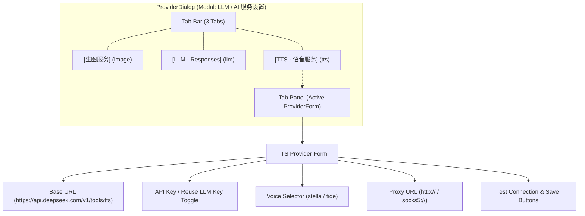
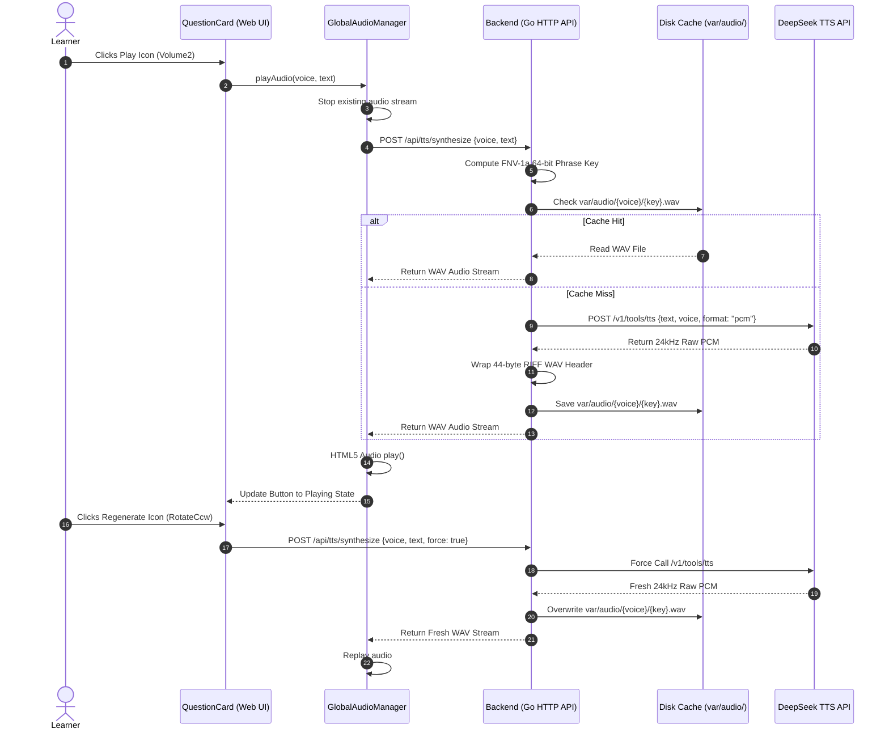

# Unified DeepSeek TTS Integration Architecture and Specification

This document specifies the technical design, data contracts, security model, and
interaction architecture for integrating DeepSeek Text-to-Speech (TTS) into the
learning platform.

## 1. Overview and Problem Statement

Language learning in curriculum modules (e.g., `step-up-english-1` and
`step-up-english-2`) requires auditory reinforcement alongside text. Learners need:
1. Native speech playback for English vocabulary, dialogue quotes, and listening
   transcripts.
2. Immediate on-demand audio generation and regeneration controls in the question UI.
3. Persistent backend caching so subsequent plays do not incur redundant network latency
   or API quota costs.
4. Unified provider settings so the learner can configure Image, LLM, and TTS services
   in one centralized modal with shared credential options.

### Key Functional Requirements
- **Unified 3-Tab Settings Modal**: Extend the existing `ProviderDialog` from 2 tabs
  (`image`, `llm`) to 3 tabs (`image`, `llm`, `tts`), allowing full configuration of
  speech synthesis alongside reasoning and image generation.
- **Credential Reuse & Keyring Security**: DeepSeek TTS credentials can be configured
  independently or toggle-reused from DeepSeek LLM settings, stored securely in the host
  OS Keyring without exposing cleartext to the client.
- **Audio Extraction Rules**: Identify which text should receive speech synthesis
  (e.g., English options, dialogue quotes in question stems like `"Stop!"`, listening
  scripts) while strictly filtering out grammar fill-in-the-blank items (Anti-Cloze
  guardrail).
- **Audio Storage & Deduplication**: Cache synthesized 24kHz WAV audio files in
  `var/audio/{voice_id}/{phrase_key}.wav`, using 64-bit FNV-1a phrase hashing and backend
  singleflight concurrency deduplication.
- **UI Playback & Generation Controls**: Render play (`<Volume2 />`) and regenerate
  (`<RotateCcw />`) icon buttons on question items with global single-instance playback.

---

## 2. Unified Provider Settings: 3-Tab UI Architecture

### 2.1 Tab Navigation in `ProviderDialog`
The settings dialog (`web/src/features/palace/ProviderDialog.tsx`) is expanded from:
```typescript
type Kind = 'image' | 'llm';
const kinds: Kind[] = ['image', 'llm'];
```
to:
```typescript
type Kind = 'image' | 'llm' | 'tts';
const kinds: Kind[] = ['image', 'llm', 'tts'];
```

The tab bar renders three tabs with ARIA accessibility roles and keyboard navigation:
1. **生图服务** (`kind === 'image'`): Palace image generation models (`gpt-image-2`, etc.).
2. **LLM · Responses** (`kind === 'llm'`): Reasoning models (`deepseek-reasoner`, etc.).
3. **TTS · 语音服务** (`kind === 'tts'`): Speech synthesis models and voices (`stella`, `tide`).



### 2.2 Form Fields for TTS Tab
When `kind === 'tts'`, `ProviderForm` renders:
- **Base URL**: Defaults to `https://api.deepseek.com/v1/tools/tts`.
- **Voice Selection**: Dropdown or radio selector for available voices:
  - `stella`: Professional female voice (default for standard British/American clarity).
  - `tide`: Resonant male voice (for dialogue distinction).
- **API Key & Reuse Option**:
  - `reuse_llm_key` Checkbox: "复用 LLM 服务商密钥". When checked and the active LLM
    provider is DeepSeek, the TTS service reuses the LLM credential directly, avoiding
    redundant key entry.
  - Standalone API Key input: When `reuse_llm_key` is false, accepts a dedicated
    DeepSeek API key.
- **Proxy URL**: Optional HTTP/HTTPS/SOCKS5 proxy, matching the repository's strict proxy
  invariant (no direct fallback when a proxy is configured).
- **Connection Test Button**: Sends a lightweight dry-run synthesis request (e.g., text
  `"OK"`) to verify network connectivity and credential validity.

---

## 3. DeepSeek TTS API Specification and Audio Processing

### 3.1 DeepSeek TTS API Protocol
- **Endpoint**: `POST https://api.deepseek.com/v1/tools/tts`
- **Headers**:
  - `Content-Type: application/json`
  - `Authorization: Bearer <DEEPSEEK_API_KEY>`
- **Request Body**:
  ```json
  {
    "text": "The light doesn't work.",
    "voice": "stella",
    "format": "pcm"
  }
  ```
- **Response**: Binary raw PCM audio stream (HTTP 200) or JSON error response.
- **Audio Stream Characteristics**:
  - Sample Rate: 24,000 Hz (24 kHz)
  - Bit Depth: 16-bit Signed Integer (Little-Endian)
  - Channels: 1 (Mono)
  - Bitrate: 384 kbps uncompressed PCM

### 3.2 24kHz PCM to RIFF WAV Container Synthesis
Browsers cannot reliably stream raw headerless PCM through the standard HTML5 `<audio>`
element. The backend Go service encapsulates incoming PCM bytes with a standard 44-byte
RIFF WAV header prior to writing to disk and serving:

```
00-03: "RIFF"
04-07: ChunkSize (36 + SubChunk2Size, Little-Endian uint32)
08-11: "WAVE"
12-15: "fmt "
16-19: SubChunk1Size (16 for PCM, Little-Endian uint32)
20-21: AudioFormat (1 = PCM, Little-Endian uint16)
22-23: NumChannels (1 = Mono, Little-Endian uint16)
24-27: SampleRate (24000, Little-Endian uint32)
28-31: ByteRate (24000 * 1 * 2 = 48000, Little-Endian uint32)
32-33: BlockAlign (1 * 2 = 2, Little-Endian uint16)
34-35: BitsPerSample (16, Little-Endian uint16)
36-39: "data"
40-43: SubChunk2Size (Length of PCM data, Little-Endian uint32)
44-..: Raw PCM Audio Bytes
```

### 3.3 Phrase Key Hashing Algorithm (FNV-1a 64-bit)
To maintain 100% interoperability with `.agents/skills/maintain-deepseek-tts-audio`, the
cache key for any synthesized phrase is computed using 64-bit FNV-1a on the normalized
text (trimmed whitespace, normalized Unicode):

```
Offset Basis = 0xcbf29ce484222325
FNV Prime    = 0x100000001b3

For each byte b in normalized UTF-8 string:
  hash = (hash ^ uint64(b)) * FNV Prime

Result: 16-character lowercase hex string: fmt.Sprintf("%016x", hash)
```

Example: `"The light doesn't work."` -> `var/audio/stella/9a3f2b8014e5c8a2.wav`.

---

## 4. Text Audio Extraction Rules: What to Synthesize vs What to Exclude

Audio generation must be contextually appropriate. Unconditional synthesis of all text
damages the pedagogical experience (e.g., reading grammar blanks aloud confuses learners).

### 4.1 Audio Eligible Content (Synthesize)
1. **Target Language in Options**:
   - Pure English option text in vocabulary and sentence completion exercises.
   - Example: Option A: `"The light doesn't work."` -> Synthesize option text.
2. **Key Dialogue & Exclamations in Stems**:
   - When a stem presents a spoken phrase or dialogue prompt enclosed in quotation marks
     or backticks.
   - Example: Stem: `在装配线工作时，机器突然发生故障，工友大声对你说：Stop! 此时你应该：`
   - Extracted speech target: `"Stop!"`.
3. **Listening Comprehension Scripts (`transcript`)**:
   - **Dialogue format**: Alternating speaker lines prefixed by roles, e.g.:
     - `M: Excuse me, where is the safety switch?` -> Voice: `tide`
     - `W: It is right next to the emergency valve.` -> Voice: `stella`
   - **Passage reading**: Monologue/lecture text read continuously by standard voice.

### 4.2 Audio Ineligible Content (Strictly Excluded)
1. **Grammar Fill-in-the-Blank Stems (Anti-Cloze Filter)**:
   - When a stem or sentence contains blank placeholders (`___`, `(   )`, `{{1}}`, `[ ]`),
     it is testing syntactic choice rather than listening comprehension.
   - Example: `在车间向同事介绍自己的家乡时，想表达“我来自云南”，横线处应填入哪个介词？I am ___ Yunnan.`
   - Filter rule: Matches `CLOZE_BLANK_PATTERN`:
     ```regexp
     _{2,}|\([ _\t]*\)|\{\{\d+\}\}|\[[ _\t]*\]
     ```
   - Action: **Suppress automatic speech extraction**. Only explicit options or confirmed
     complete sentences are eligible.
2. **Chinese Instruction Metatext**:
   - System prompts such as `请根据短文内容选择最佳答案` or `下列说法中正确的是` are UI instructions
     and must not be sent to English TTS.

---

## 5. Storage, Caching, and Concurrency Architecture

### 5.1 Storage Directory Structure
All synthesized audio is persisted on disk under the application data directory:
```
var/
└── audio/
    ├── stella/
    │   ├── 9a3f2b8014e5c8a2.wav
    │   └── e01c89f538a719bd.wav
    └── tide/
        ├── 14a8bd90ef256c71.wav
        └── c3b910a267ef8401.wav
```

### 5.2 Singleflight Concurrency Deduplication
When multiple UI clients or components request synthesis for the same text and voice
simultaneously, the backend wraps the synthesis call in a `singleflight.Group`:
1. Request 1 arrives -> initiates API call to DeepSeek.
2. Request 2 arrives with identical key -> joins Request 1's in-flight execution.
3. API returns -> both requests receive the cached result simultaneously; only 1 API call
   is billed.

### 5.3 Cache Invalidation and Regeneration
- Normal Play (`GET /api/audio/:voice/:key.wav` or `POST /api/tts/synthesize`):
  Checks disk first. On cache hit, streams file with `Content-Type: audio/wav` and
  `Cache-Control: public, max-age=31536000, immutable`.
- Force Regenerate (`POST /api/tts/synthesize` with `force: true`):
  Bypasses disk cache, calls DeepSeek TTS API, overwrites existing file, and returns
  updated audio.

---

## 6. Frontend UI Components and Interaction Flow

### 6.1 Audio Control Buttons on Question Items
Each eligible audio segment renders an `AudioControls` container with two buttons:
1. **Play Button (`<Volume2 />`)**:
   - Default State: Outline icon with tooltip "播放发音".
   - Loading State: Animated spinner (`<LoaderCircle className="spin" />`).
   - Playing State: High-contrast speaker icon with sound waves (`<Volume2 className="active" />`).
   - Action: If audio is cached, plays immediately. If not cached, triggers background
     synthesis, caches the audio, and begins playback.
2. **Generate / Regenerate Button (`<RotateCcw />` / `<Sparkles />`)**:
   - Renders as a small secondary icon button with tooltip "重新生成发音".
   - Action: Invokes `POST /api/tts/synthesize` with `force: true`, bypassing cache.

### 6.2 Global Single-Instance Audio Manager (`globalAudio`)
To prevent acoustic chaos from overlapping audio streams, the frontend maintains a
singleton `HTMLAudioElement`:
- Starting playback on any button immediately calls `globalAudio.pause()` and resets the
  playback state of previously active buttons.
- Supports native keyboard shortcuts: Space bar to pause/resume currently active audio.



---

## 7. HTTP API Contracts

### 7.1 Stream Audio (`GET /api/audio/:voice/:key.wav`)
- **Query / Path Parameters**:
  - `voice`: `stella` | `tide`
  - `key`: 16-character hex phrase key
- **Responses**:
  - `200 OK`: Binary `audio/wav` stream with caching headers.
  - `404 Not Found`: Audio file has not been synthesized yet.

### 7.2 Synthesize Audio (`POST /api/tts/synthesize`)
- **Request Body**:
  ```json
  {
    "text": "The light doesn't work.",
    "voice": "stella",
    "force": false
  }
  ```
- **Responses**:
  - `200 OK`:
    ```json
    {
      "key": "9a3f2b8014e5c8a2",
      "voice": "stella",
      "audio_url": "/api/audio/stella/9a3f2b8014e5c8a2.wav",
      "cached": true,
      "duration_ms": 1420
    }
    ```
  - `400 Bad Request`: Text exceeds 10,000 characters or invalid voice ID.
  - `401 / 403`: TTS API key missing or invalid.
  - `502 Bad Gateway`: Upstream DeepSeek TTS API error.

### 7.3 TTS Settings Management
- `GET /api/tts/settings`: Returns current configuration (base URL, voice, storage type,
  `key_configured`, `reuse_llm_key`).
- `PUT /api/tts/settings`: Updates base URL, voice, proxy, and saves new API key to OS
  Keyring.
- `POST /api/tts/test`: Dry-run synthesis with test phrase to verify configuration.
