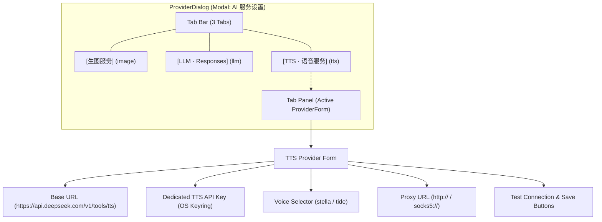

# Unified DeepSeek TTS Integration Architecture and Specification

This document specifies the technical design, data contracts, security model, and
interaction architecture for integrating DeepSeek Text-to-Speech (TTS) into the
learning platform.

## 1. Overview and Design Principles

Language learning in curriculum modules (e.g., `beginner-english` and the
`golden-course-template` demo) requires auditory reinforcement alongside text. Learners need:
1. Native speech playback for English vocabulary, dialogue quotes, and listening
   transcripts.
2. Immediate on-demand audio generation and regeneration controls in the question UI.
3. Persistent backend caching so subsequent plays do not incur redundant network latency
   or API quota costs.
4. Unified provider settings so the learner can configure Image, LLM, and TTS services
   in one centralized modal with shared credential options.

### Key Architectural Decisions
- **Declarative Rich Content Model (No Heuristic String Parsing)**:
  Question stems, passages, and options are defined using a structured array of content
  segments (`ContentSegment[]`) in the question JSON rather than opaque flat strings.
  TTS capability is explicitly declared on the segment object. If a segment declares TTS,
  the UI renders both the text and its audio play/regenerate controls; if omitted, only
  plain text is rendered.
- **Unified 3-Tab Settings Modal**:
  Extend `ProviderDialog` from 2 tabs (`image`, `llm`) to 3 tabs (`image`, `llm`, `tts`),
  allowing centralized configuration of speech synthesis alongside reasoning and image
  generation.
- **Independent Credential & Keyring Security**:
  DeepSeek TTS credentials are managed independently from LLM and Image keys, stored
  securely in the host OS Keyring without exposing cleartext to the client.
- **Deterministic Audio Caching**:
  Cache synthesized 24kHz WAV audio files in `var/audio/{voice_id}/{phrase_key}.wav`,
  using 64-bit FNV-1a phrase hashing and backend singleflight concurrency deduplication.

---

## 2. Unified Provider Settings: 3-Tab UI Architecture

### 2.1 Tab Navigation in `ProviderDialog`
The settings dialog (`web/src/features/palace/ProviderDialog.tsx`) is expanded from:
```typescript
type Kind = 'image' | 'llm';
const kinds: Kind[] = ['image', 'llm'];
```
to:
```typescript
type Kind = 'image' | 'llm' | 'tts';
const kinds: Kind[] = ['image', 'llm', 'tts'];
```

The tab bar renders three tabs with ARIA accessibility roles and keyboard navigation:
1. **生图服务** (`kind === 'image'`): Palace image generation models (`gpt-image-2`, etc.).
2. **LLM · Responses** (`kind === 'llm'`): Reasoning models (`deepseek-reasoner`, etc.).
3. **TTS · 语音服务** (`kind === 'tts'`): Speech synthesis models and voices (`stella`, `tide`).



### 2.2 Form Fields for TTS Tab
When `kind === 'tts'`, `ProviderForm` renders:
- **Base URL**: Defaults to `https://api.deepseek.com/v1/tools/tts`.
- **API Key**: Dedicated DeepSeek TTS API key input field. Like LLM and Image keys,
  it is saved directly to the system keyring, never echoed to the client or written in
  cleartext.
- **Voice Selection**: Radio/select control for available voices:
  - `stella`: Professional female voice (default for standard British/American clarity).
  - `tide`: Resonant male voice (for dialogue differentiation).
- **Proxy URL**: Optional HTTP/HTTPS/SOCKS5 proxy, matching the repository's strict proxy
  invariant (no direct fallback when a proxy is configured).
- **Connection Test Button**: Sends a lightweight dry-run synthesis request (e.g., text
  `"OK"`) to verify network connectivity and credential validity.

---

## 3. Declarative Rich Content & In-line TTS Mixed Layout

Rather than relying on heuristic string parsing or regular expressions (which risk
accidental reads of blanks like `___`), TTS capability is explicitly declared in the
course item JSON. Question stems, options, and passages can be structured as either a
simple string (for backward compatibility) or an array of content segments.

### 3.1 Content Segment Data Contract
```typescript
export interface TTSConfig {
  voice?: 'stella' | 'tide';
  text?: string;        // Optional alternate text to speak (e.g., spoken form of symbols)
  speed?: number;       // Optional playback rate factor (default 1.0)
}

export interface ContentSegment {
  type: 'text' | 'speech' | 'blank';
  text?: string;
  tts?: boolean | TTSConfig;
  index?: number;       // For 'blank' segment in Cloze questions
}

export type RichContent = string | ContentSegment[];
```

### 3.2 Canonical Concrete Examples

#### Case 1: Mixed In-line Stem Dialogue (`Stop!`)
When a sentence contains an spoken exclamation or dialogue segment within narrative text:
```json
{
  "id": "item-sue1-sc-012",
  "type": "single_choice",
  "stem": [
    { "type": "text", "text": "在装配线工作时，机器突然发生故障，工友大声对你说：" },
    { "type": "text", "text": "Stop!", "tts": { "voice": "tide" } },
    { "type": "text", "text": " 此时你应该：" }
  ],
  "options": [
    { "id": "a", "text": "立即按下红色急停按钮并停止操作" },
    { "id": "b", "text": "继续操作并等待班长到来" },
    { "id": "c", "text": "关掉车间总照明灯" },
    { "id": "d", "text": "大声向工友回复无需惊慌" }
  ],
  "grading": { "choice_ids": ["a"] }
}
```
**UI Render Result**:
- The introductory text `"在装配线工作时，机器突然发生故障，工友大声对你说："` displays as text.
- `"Stop!"` displays in high-contrast code/tag style immediately followed by inline
  `<Volume2 />` (play) and `<RotateCcw />` (regenerate) icons.
- The trailing text `" 此时你应该："` displays as text.
- Zero heuristic parsing required.

#### Case 2: Options with English Speech (`The light doesn't work.`)
When options contain English phrases that require pronunciation:
```json
{
  "id": "item-sue1-sc-013",
  "type": "single_choice",
  "stem": "工人向维修工汇报车间照明指示灯故障时，最地道的英文表达是：",
  "options": [
    { "id": "a", "text": "The light doesn't work.", "tts": { "voice": "stella" } },
    { "id": "b", "text": "The light is dead person.", "tts": { "voice": "stella" } },
    { "id": "c", "text": "No light working now.", "tts": { "voice": "stella" } },
    { "id": "d", "text": "The light loses power heart.", "tts": { "voice": "stella" } }
  ],
  "grading": { "choice_ids": ["a"] }
}
```
**UI Render Result & Anti-Leakage Uniformity Rule**:
- **Anti-Leakage Invariant (防剧透一致性法则)**: If TTS is enabled for options, **ALL options
  in that question (or blank) MUST uniformly have TTS enabled**. Enabling TTS exclusively
  on the correct choice leaks the answer to learners before answering.
- Every option uniformly renders its text alongside play (`<Volume2 />`) and regenerate
  (`<RotateCcw />`) icon buttons, ensuring fair visual presentation and authentic listening
  comparison across all choices.

#### Case 3: Grammar Fill-in-the-Blank (No Audio by Definition)
In grammar syntax questions containing blank lines:
```json
{
  "id": "item-sue1-sc-014",
  "type": "single_choice",
  "stem": [
    { "type": "text", "text": "在车间向同事介绍自己的家乡时，想表达“我来自云南”，横线处应填入哪个介词？\n" },
    { "type": "text", "text": "I am ___ Yunnan." }
  ],
  "options": [
    { "id": "a", "text": "from" },
    { "id": "b", "text": "at" },
    { "id": "c", "text": "in" },
    { "id": "d", "text": "on" }
  ],
  "grading": { "choice_ids": ["a"] }
}
```
**UI Render Result**:
- Neither the stem segments nor the options declare `tts`.
- Both the instruction and `"I am ___ Yunnan."` render strictly as text.
- No TTS controls appear, eliminating any possibility of speech engines attempting to
  read out underscores or placeholder symbols.

#### Case 4: Listening Multi-Speaker Dialogue
Dialogue listening scripts define speaker tags and explicit voices per line:
```json
{
  "id": "item-sue1-list-003",
  "type": "listening",
  "stem": "Listen to the conversation and answer the question.",
  "transcript": [
    { "speaker": "M", "text": "Excuse me, where is the emergency valve?", "tts": { "voice": "tide" } },
    { "speaker": "W", "text": "It is right next to the main transformer.", "tts": { "voice": "stella" } }
  ]
}
```
**UI Render Result**:
- Line 1 renders `M:` badge, line text, and controls invoking `voice: "tide"`.
- Line 2 renders `W:` badge, line text, and controls invoking `voice: "stella"`.

---

## 4. Frontend Rendering Architecture: `RichContent` Component

To support mixed inline rendering effortlessly across all question views, a shared
component `RichContent` is introduced in `web/src/components/RichContent.tsx`:

```tsx
import { AudioControls } from './AudioControls';
import type { RichContent as RichContentType, ContentSegment } from '../api/course';

export function RichContent({ content, defaultVoice = 'stella' }: {
  content: RichContentType;
  defaultVoice?: 'stella' | 'tide';
}) {
  if (typeof content === 'string') {
    return <span className="rich-content-text">{content}</span>;
  }
  return (
    <span className="rich-content-mixed">
      {content.map((segment, index) => {
        if (!segment.tts) {
          return <span key={index} className="rich-segment-text">{segment.text}</span>;
        }
        const ttsConfig = typeof segment.tts === 'object' ? segment.tts : {};
        const voice = ttsConfig.voice || defaultVoice;
        const textToSpeak = ttsConfig.text || segment.text || '';
        return (
          <span key={index} className="rich-segment-speech">
            <span className="rich-speech-text">{segment.text}</span>
            <AudioControls text={textToSpeak} voice={voice} />
          </span>
        );
      })}
    </span>
  );
}
```

---

## 5. DeepSeek TTS API Specification and Audio Processing

### 5.1 DeepSeek TTS API Protocol
- **Endpoint**: `POST https://api.deepseek.com/v1/tools/tts`
- **Headers**:
  - `Content-Type: application/json`
  - `Authorization: Bearer <DEEPSEEK_API_KEY>`
- **Request Body**:
  ```json
  {
    "text": "The light doesn't work.",
    "voice": "stella",
    "format": "pcm"
  }
  ```
- **Response**: Binary raw PCM audio stream (HTTP 200) or JSON error response.
- **Audio Stream Characteristics**:
  - Sample Rate: 24,000 Hz (24 kHz)
  - Bit Depth: 16-bit Signed Integer (Little-Endian)
  - Channels: 1 (Mono)
  - Bitrate: 384 kbps uncompressed PCM

### 5.2 24kHz PCM to RIFF WAV Container Packaging
Browsers cannot reliably stream raw headerless PCM through the standard HTML5 `<audio>`
element. The backend Go service encapsulates incoming PCM bytes with a standard 44-byte
RIFF WAV header prior to writing to disk and serving:

```
00-03: "RIFF"
04-07: ChunkSize (36 + SubChunk2Size, Little-Endian uint32)
08-11: "WAVE"
12-15: "fmt "
16-19: SubChunk1Size (16 for PCM, Little-Endian uint32)
20-21: AudioFormat (1 = PCM, Little-Endian uint16)
22-23: NumChannels (1 = Mono, Little-Endian uint16)
24-27: SampleRate (24000, Little-Endian uint32)
28-31: ByteRate (24000 * 1 * 2 = 48000, Little-Endian uint32)
32-33: BlockAlign (1 * 2 = 2, Little-Endian uint16)
34-35: BitsPerSample (16, Little-Endian uint16)
36-39: "data"
40-43: SubChunk2Size (Length of PCM data, Little-Endian uint32)
44-..: Raw PCM Audio Bytes
```

### 5.3 Phrase Key Hashing Algorithm (FNV-1a 64-bit)
To maintain 100% interoperability with `.agents/skills/maintain-deepseek-tts-audio`, the
cache key for any synthesized phrase is computed using 64-bit FNV-1a on the normalized
text (trimmed whitespace, normalized Unicode):

```
Offset Basis = 0xcbf29ce484222325
FNV Prime    = 0x100000001b3

For each byte b in normalized UTF-8 string:
  hash = (hash ^ uint64(b)) * FNV Prime

Result: 16-character lowercase hex string: fmt.Sprintf("%016x", hash)
```

Example: `"Stop!"` -> `var/audio/tide/17f8a3d1004bca91.wav`.

---

## 6. Storage, Caching, and Concurrency Architecture

### 6.1 Storage Directory Structure
All synthesized audio is persisted on disk under the application data directory:
```
var/
└── audio/
    ├── stella/
    │   ├── 9a3f2b8014e5c8a2.wav
    │   └── e01c89f538a719bd.wav
    └── tide/
        ├── 17f8a3d1004bca91.wav
        └── c3b910a267ef8401.wav
```

### 6.2 Singleflight Concurrency Deduplication
When multiple UI clients or components request synthesis for the same text and voice
simultaneously, the backend wraps the synthesis call in a `singleflight.Group`:
1. Request 1 arrives -> initiates API call to DeepSeek.
2. Request 2 arrives with identical key -> joins Request 1's in-flight execution.
3. API returns -> both requests receive the cached result simultaneously; only 1 API call
   is billed.

### 6.3 Cache Invalidation and Regeneration
- Normal Play (`GET /api/audio/:voice/:key.wav` or `POST /api/tts/synthesize`):
  Checks disk first. On cache hit, streams file with `Content-Type: audio/wav` and
  `Cache-Control: public, max-age=31536000, immutable`.
- Force Regenerate (`POST /api/tts/synthesize` with `force: true`):
  Bypasses disk cache, calls DeepSeek TTS API, overwrites existing file, and returns
  updated audio.

---

## 7. Frontend UI Controls & Global Playback Manager

### 7.1 Interactive Audio Controls (`AudioControls`)
Each speech-enabled segment renders:
1. **Play Button (`<Volume2 />`)**:
   - Default: Outline speaker icon with tooltip "播放发音".
   - Loading: Animated spinner (`<LoaderCircle className="spin" />`).
   - Playing: Active high-contrast speaker icon.
   - Click: If cached, plays immediately; if uncached, triggers synthesis, caches on
     disk, and starts playback.
2. **Generate / Regenerate Button (`<RotateCcw />`)**:
   - Small secondary icon button with tooltip "重新生成发音".
   - Click: Forces re-synthesis via `POST /api/tts/synthesize` with `force: true`.

### 7.2 Global Single-Instance Audio Manager (`globalAudio`)
The frontend maintains a singleton audio player to prevent acoustic overlap:
- Triggering any play action immediately halts the active audio track and resets its
  button state.
- Supports keyboard spacebar toggle for pause/resume of the active track.

---

## 8. HTTP API Contracts

### 8.1 Audio Stream Retrieval (`GET /api/audio/:voice/:key.wav`)
- Path parameters: `voice` (`stella` | `tide`), `key` (16-char hex).
- Returns: `audio/wav` binary stream.

### 8.2 Synthesize / Regenerate (`POST /api/tts/synthesize`)
- Request Body:
  ```json
  {
    "text": "The light doesn't work.",
    "voice": "stella",
    "force": false
  }
  ```
- Response:
  ```json
  {
    "key": "9a3f2b8014e5c8a2",
    "voice": "stella",
    "audio_url": "/api/audio/stella/9a3f2b8014e5c8a2.wav",
    "cached": true,
    "duration_ms": 1420
  }
  ```
