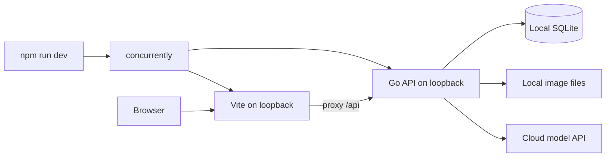

# Technology Selection for Local AI Engineering Study

Review date: 2026-11-01. Status: initial proposal retained for reference.
Implemented image-provider choices and module boundaries supersede the initial
AI SDK proposal; see [image generation selection](../image-generation/README.md).

## Recommended stack

Use a local React/Vite application with a Go HTTP backend, embedded SQLite,
local image files, and the official OpenAI Go SDK. One npm command starts the
frontend and backend. Node is the frontend toolchain and development server;
Go owns scoring, persistence, learning analysis, and paid model requests.

| Concern | Initial choice | Reason |
| --- | --- | --- |
| Frontend | React, strict TypeScript, Vite | Interactive private application; static build. |
| Navigation | React Router, Declarative mode | Small route set without a framework server. |
| Server state | TanStack Query, native fetch | Loading, mutations, caching, job polling. |
| Components | Tailwind, selected shadcn/ui Radix components | Consistent UI with owned component source. |
| Charts | Recharts, when analysis screens are implemented | React integration for ordinary study charts. |
| API types | OpenAPI plus openapi-typescript | One HTTP contract, generated frontend declarations. |
| Backend | Go net/http, encoding/json, slog | Standard routing, JSON, logging, request contexts. |
| Database | SQLite, database/sql, modernc.org/sqlite | Local file, no database server, no CGO requirement. |
| Queries | SQL and sqlc | Checked Go bindings for learning metrics. |
| Migrations | Goose library with embedded SQL | Automatic application startup migrations. |
| AI | Official OpenAI Go SDK | Text, structured recommendations, vision, images. |
| Image jobs | SQLite image_jobs table and one Go worker | Durable local state without another service. |
| Image storage | Local var/generated-images directory | No object-storage account or service. |
| Development startup | npm scripts and concurrently | Starts both processes and coordinates shutdown. |
| Verification | Go tests, Vitest, Playwright | Domain rules, UI state, complete local workflows. |

React documents this assembled Vite/router/server-state approach. React Router
has a Declarative mode without its framework plugin. Modernc is CGo-free, and
sqlc documents its SQLite/database/sql integration. These are capability facts;
the stack choice is an engineering recommendation. Sources:
[React](https://react.dev/learn/build-a-react-app-from-scratch),
[Router](https://reactrouter.com/start/modes),
[modernc](https://pkg.go.dev/modernc.org/sqlite),
[sqlc](https://docs.sqlc.dev/en/stable/tutorials/getting-started-sqlite.html).

## Local startup and deployment

The proposed user command is `npm run dev`, after initial installation of
Node/npm, a compatible supported Go toolchain, npm dependencies, and Go modules.
Use Node 26 LTS: the official October 28 release records its actual LTS
transition. npm does not replace the Go compiler. Sources:
[Node release](https://github.com/nodejs/node/releases/tag/v26.13.0),
[Go compilation](https://go.dev/doc/tutorial/compile-install).

Use relative `/api` URLs and Vite's development proxy. A built application can
serve its static frontend and API from Go on one loopback origin. Preserve
normal API and missing-asset errors rather than routing them to index.html.
`vite preview` is a build preview tool. Sources:
[Vite proxy](https://vite.dev/config/server-options.html#server-proxy),
[Vite deployment](https://vite.dev/guide/static-deploy.html).

Bind both servers to loopback. Keep credentials in the Go environment, outside
Vite's public environment variables and browser bundles. Validate local Host and
Origin for state-changing requests. A login framework is outside the initial
single-user requirement. Local storage does not make model inference local.

## Evidence from the supplied collection

The export contains 2849 repository records and 2395 scans covering 2195 distinct
repositories. Only 379 scans have both a dependency path and extracted target
dependency hits. Another 714 have a path without target hits, and 1302 have no
path. These are evidence definitions, not quality grades. All 106 Go scans lack
dependency hits, so this export cannot substantiate Go package adoption.

| Exact dependency/category | first | second | second-under1k | Distinct sampled repositories |
| --- | ---: | ---: | ---: | ---: |
| tailwindcss / ui | 18 | 61 | 49 | 128 |
| vite / bundler | 17 | 58 | 48 | 123 |
| next / bundler | 13 | 25 | 14 | 52 |
| @radix-ui/react-dialog / ui | 3 | 19 | 13 | 35 |
| @xyflow/react / canvas | 2 | 9 | 8 | 19 |
| @xyflow/react / workflow_edges_layout | 2 | absent | absent | 2 |
| langchain / Python | 22 | 49 | 10 | 81 |
| langgraph / Python | 7 | 24 | 10 | 41 |

Counts are unions within an exact dependency/category across named batches.
Do not add the two React Flow categories, merge package aliases, or interpret
these samples as market share. A missing batch row is not an observed zero.
Popularity is candidate evidence, not a reason to add a dependency.
The curated list's date is 2026-10-25; its version and star claims are not pins.
Recomputed counts, limitations, and input fingerprints are in
[local-evidence.json](local-evidence.json).

## Learning analysis and recommendations

Go and SQL determine correct answers, exam scores, coverage, elapsed time,
first-attempt accuracy, recent review accuracy, and per-chapter results. Keep
first attempts separate from repeated memorized answers. Display sample counts
with rates, and avoid presenting a small or biased practice sample as a reliable
exam-score prediction.

The imported questions already have subjects, chapters, tags, and difficulty.
Some course and subchapter IDs are zero; do not invent a finer classification.
Store question-set versions and immutable exam question snapshots with attempts.
Question selection, scoring, deadlines, pause policy, and exam rules belong in
Go. Exam rules need a separately confirmed specification before implementation.

For an advice request, Go selects relevant metrics and example questions, then
asks the model for a schema-constrained explanation and study plan. Validate
all returned question IDs, subject membership, numeric bounds, and evidence
references in Go. Record the metric snapshot, model, prompt version, and result.
The model may explain priorities; it does not overwrite scores or answer keys.
Structured output guarantees a supported format, not factual correctness.
Source: [structured outputs](https://developers.openai.com/api/docs/guides/structured-outputs).

Generate advice on request or after an explicit session summary, not after every
answer. SQL queries and original explanations cover ordinary feedback without
a model call. Initially, select relevant records by IDs and chapters; a vector
database or RAG framework adds no demonstrated capability for this requirement.

## Model and image selection

OpenAI is the initial provider because one official Go SDK covers the required
capabilities. This is an integration decision, not a Chinese-text quality claim.
Current candidate IDs are `gpt-6-luna` for compact recommendations and
`gpt-image-2.5-flare` for image generation. Keep them configurable. Compare a
stronger text candidate such as `gpt-6.1-sol` only if the evaluation finds a
specific problem. These are documented candidates, not tested account access.
Sources: [text model](https://developers.openai.com/api/docs/models/gpt-6-luna),
[catalogue](https://developers.openai.com/api/docs/models),
[images](https://developers.openai.com/api/docs/guides/image-generation).

Use Responses with structured outputs for advice and the Images API for a
single fixed-template generation or edit. A conversational image workflow can
use Responses later if needed. Anthropic is a text/vision alternative but does
not generate raster images. Google has text/image alternatives; adoption is
conditional on account eligibility, current terms, and an actual local quality
evaluation. Sources:
[Anthropic vision](https://platform.claude.com/docs/en/build-with-claude/vision),
[Google images](https://ai.google.dev/gemini-api/docs/image-generation),
[Google terms](https://ai.google.dev/gemini-api/terms).

Preserve the supplied memory-palace template in full. Substitute its four
variables without shortening its instructions. Supply all option text and map
answer numbers to answer text. Attach the original question image when present.
The source still lacks 135 referenced images, including 86 for subject 1; show
that absence rather than reconstructing an unseen diagram as a factual source.

A generated Chinese infographic can contain incorrect labels or poor text
placement. Keep original explanations available and require user review before
treating an image as a study aid. If exact labels become essential, a separate
versioned design can combine generated illustrations with deterministic text
rendering. No provider quality comparison was performed. Source:
[image limitations](https://developers.openai.com/api/docs/guides/image-generation).

Evaluate 20 representative local questions before fixing models: text-only,
diagram-dependent, true/false, multiple-choice, numeric signs, and the supplied
9:16 template. Record answer fidelity, Chinese text fidelity, diagram fidelity,
latency, and returned usage. Do not infer a fixed image price without size,
quality, usage, and a dated price table. No paid requests were made for this
selection. Source: [pricing](https://developers.openai.com/api/docs/pricing).

## Durable local data and image work

Use `var/study.sqlite` for mutable learning data and keep the imported data and
source images unchanged. Start with one database connection, foreign keys
enabled per connection, bounded busy waits, and short transactions. Default
rollback journaling is sufficient initially. Do not hold a transaction during
model calls. SQLite still has only one writer if WAL is enabled later. Sources:
[transactions](https://www.sqlite.org/lang_transaction.html),
[foreign keys](https://www.sqlite.org/foreignkeys.html#fk_enable),
[connection pools](https://go.dev/doc/database/manage-connections).

If WAL is enabled, use a locally stored database and a SQLite engine containing
the documented WAL-reset fix, such as 3.51.3 or later. Verify the actual engine,
not merely the Go driver version. Back up live databases through supported
SQLite backup methods, together with generated images. Sources:
[WAL fix](https://www.sqlite.org/wal.html#walreset),
[backup](https://www.sqlite.org/backup.html).

An image request and queued job are committed together with a unique local
request ID. One worker claims a job, commits, and calls the provider. Save output
to a temporary file, rename it atomically, then mark success. Store the question
version, full rendered prompt or its reproducible inputs, model, attempt state,
provider identifier when available, result path, and returned usage.

Poll persisted job status with TanStack Query while a job is active. SSE is an
optional later transport; job state remains authoritative. Navigating away does
not cancel an accepted job. On restart, distinguish queued jobs from interrupted
requests whose provider outcome is unknown. Do not automatically resubmit an
uncertain paid request without supported idempotency or result lookup.

Define one bounded retry policy across the SDK and job worker; OpenAI's SDK
already retries eligible failures twice by default. Cancellation during a call
does not guarantee no charge. Cache successful output for an unchanged input,
limit image concurrency to one, and expose explicit regeneration. Sources:
[SDK retry behavior](https://github.com/openai/openai-go#retries),
[background cancellation](https://developers.openai.com/api/docs/guides/background).

## Deferred choices and adoption triggers

| Candidate | Decision and trigger |
| --- | --- |
| Next.js | Revisit for public rendering or an actual server-rendering need; static export is possible, but unnecessary here. |
| TanStack Router | Revisit for substantially typed URL/search-state requirements. |
| Zod | Add for a real browser runtime-validation boundary, not duplicate Go DTOs. |
| Zustand/Redux | Add only when shared client state outgrows component state and Query. |
| Chi/Gin/GORM | Standard HTTP and generated SQL suffice; no framework/ORM requirement. |
| PostgreSQL/pgx/River | Revisit for concurrent users, workers, or measured SQLite contention. |
| Redis/Asynq | No current cache or distributed queue requirement. |
| AI SDK UI | Revisit for a substantial chat interface and its explicit stream protocol. |
| LangGraph/Mastra/CrewAI/n8n | No autonomous agent or user-editable workflow requirement. |
| Genkit Go | Stable Go option if multi-step AI composition becomes real. |
| React Flow | Add for editable workflow graphs, not ordinary image viewing. |
| Three.js/R3F | Add only for an interactive 3D product feature. |
| Excalidraw/react-konva | Add only for image editing or annotation. |
| tldraw | Not an unrestricted MIT SDK; production licensing needs separate review. |
| ECharts | Revisit for chart types or measured data volumes beyond Recharts. |

AI SDK UI can use a Go backend, but ordinary SSE is not automatically its message
protocol. The separate AI Elements project announces migration to shadcn/ui and
deprecation at the end of November 2026. Sources:
[stream protocol](https://ai-sdk.dev/docs/ai-sdk-ui/stream-protocol),
[AI Elements](https://github.com/vercel/ai-elements),
[Genkit stability](https://genkit.dev/docs/go/api-stability/),
[tldraw license](https://tldraw.dev/community/license).

## Implementation gates

Pin stable compatible packages and commit lockfiles when implementation starts.
Check package engine requirements, direct/transitive advisories, licenses, and
release status then; repository activity is not a security audit. Recharts
requires `react-is` to match the React version. Configure Query freshness and
refetch behavior so an active exam snapshot cannot be silently replaced.

Validate deterministic grading, multiple-choice equality, exam resume/deadlines,
first-attempt metrics, SQLite persistence, failed/interrupted image requests,
and model-response rejection. Verify that Ctrl-C or either child process exiting
leaves no background Go process. These are proposed gates, not executed tests.
Licenses, alternatives, replacement boundaries, and switch conditions are
recorded in [stack-selection.yaml](stack-selection.yaml).
